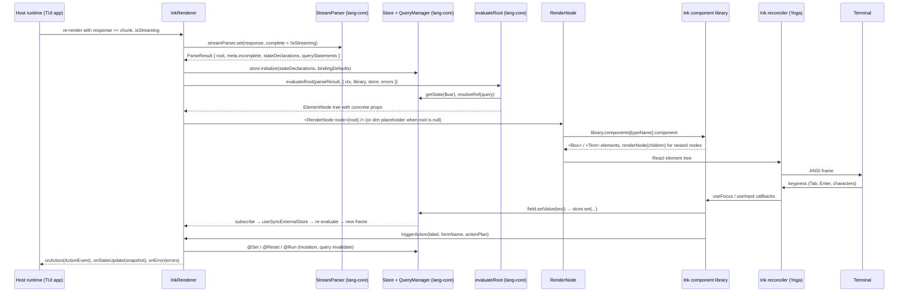

# @openuidev/ink-lang - implementation plan

Terminal (Ink) binding for OpenUI Lang. Same component schemas as the React
default library, so one generated system prompt drives both the web renderer
(`react-lang`) and the terminal renderer (`ink-lang`).

Status: implemented on `feat/ink-lang`; this document is the design record. Deviations found
during implementation are noted inline.

## 1. What the survey established

Facts checked against the source (file references are relative to the repo root).

- `lang-core` (1.0.1, `workspace:^`) already exposes everything a binding needs
  from its root barrel (`packages/lang-core/src/index.ts`): `createStreamingParser`,
  `evaluateRoot`, `createStore`, `createQueryManager`, `evaluate`, `resolveStateField`,
  `enrichErrors`, `ACTION_STEPS`, `BuiltinActionType`, `extractToolResult`,
  `ToolNotFoundError`, and the types `ElementNode`, `EvalContext`, `EvaluationContext`,
  `ActionPlan`, `ActionEvent`, `OpenUIError`, `ParseResult`, `Store`, `QueryManager`.
  `isElementNode` and `compileSchema` are internal; the binding checks
  `value.type === "element"` the way `react-lang` does.
- `react-lang` is the reference for the current runtime (1.0 language). `vue-lang`
  and `svelte-lang` still depend on the published `@openuidev/lang-core@^0.4.1`
  (0.5 language), so they are the reference for package layout only, not for the
  runtime wiring. The runtime wiring is ported from
  `packages/react-lang/src/hooks/useOpenUIState.ts`, split into small files.
- `StreamParser.set(fullText, complete)` diffs against its buffer, so the host can
  pass the accumulated response on every chunk. `ElementNode.partial` is set from
  `wasIncomplete` of the whole parse (`packages/lang-core/src/parser/parser.ts:241`),
  so it marks "this frame came from an incomplete program", not "this node is
  the one still streaming". Verified by running the parser: `meta.incomplete` is
  also only true when the last line needed auto-closing (a chunk ending in a
  newline yields `incomplete: false` even though more is coming), so the host's
  `isStreaming` prop is the only reliable "still streaming" signal. Unresolved
  references inside arrays are left out, not kept as `null` (`Stack([a, b])` with
  only `a` defined gives `children: [a]`), and a truncated inline child such as
  `Title(` is dropped with a `missing-required` error while its parent gets
  `partial: true`. The placeholder logic below is designed around these facts.
- `docs/generated/playground-library.spec.json` is a checked-in `LibrarySpec` of
  `openuiLibrary` (root `Stack`, 82 components, prompt signatures and the JSON
  Schema `$defs` in positional key order). It is the parity oracle for section 4,
  so no fixture has to be captured or maintained inside `ink-lang`.
- The default React library lives in `packages/react-ui/src/genui-lib/`
  (`openuiLibrary`, root `Stack`; `openuiChatLibrary`, root `Card`). Its schemas
  are plain Zod v4 objects in `<Component>/schema.ts`. They are not exported as a
  package subpath and importing them pulls the whole React DOM library, so
  `ink-lang` carries verbatim copies guarded by a parity test (section 4).
- Ink 8.0.0 (published 2026-10-03) requires Node >= 22 and React >= 19.3.0 and is
  ESM only. `ink-testing-library@4.0.0` renders through Ink's `render()` with fake
  streams and exposes `stdin.write()`, `lastFrame()` and `frames`. Ink's own focus
  management handles Tab / Shift+Tab; `useFocus({ id, isActive })` and
  `useInput(handler, { isActive })` are the primitives for Button and Input.
- Telemetry (reported in full in section 8): install-time telemetry in
  `lang-core`'s `postinstall`, opt-in runtime telemetry in `lang-core`'s parser
  and prompt generation, PostHog in `openui-cli` and in the docs site, a cloud
  sink in `observability-cloud`, and a jsDelivr CDN fetch in `devtools`.

## 2. Package

`packages/ink-lang`, name `@openuidev/ink-lang`, version `0.1.0`, MIT (root
`LICENSE` applies, like every other package; README links to it).

| Field              | Value                                                                                                                                       | Why                                                                                                                                                                                                                                                                                                                                           |
| ------------------ | ------------------------------------------------------------------------------------------------------------------------------------------- | --------------------------------------------------------------------------------------------------------------------------------------------------------------------------------------------------------------------------------------------------------------------------------------------------------------------------------------------- |
| `type`             | `module`, ESM-only build                                                                                                                    | Ink 8 is ESM-only; a CJS build could not load it.                                                                                                                                                                                                                                                                                             |
| `engines.node`     | `>=22`                                                                                                                                      | Ink 8 requirement. The root `engines` stays untouched.                                                                                                                                                                                                                                                                                        |
| `dependencies`     | `@openuidev/lang-core: workspace:^`                                                                                                         | Same as `react-lang`.                                                                                                                                                                                                                                                                                                                         |
| `peerDependencies` | `ink: ^8.0.0`, `react: >=19.3.0`, `zod: catalog:`                                                                                           | A single Ink and React instance must be shared with the host app, otherwise context and focus break. Pinned to the Ink 8 line.                                                                                                                                                                                                                |
| `devDependencies`  | `ink@^8.0.0`, `react@^19.3.1`, `@types/react@^19.3.0`, `ink-testing-library@^4.0.0`, `vitest@^4.1.0`, `tsx` (demo), `@types/node: catalog:` | Ink 8.0.0 (2026-10-03) and React 19.3.0 (2026-09-09) are both older than two weeks; the `^19.3.1` range resolves to the latest patch. The catalog resolves `react` to 19.2.4 for every sibling, so the lockfile gains a second React entry (19.3.x) used only by `ink-lang`; `lang-core` has no React dependency, so nothing is shared twice. |
| build              | `tsdown` (`format: ["esm"]`, `dts: true`, externals = every bare import)                                                                    | Same tool as `react-lang`; ESM-only output.                                                                                                                                                                                                                                                                                                   |
| tests              | `vitest run`, `environment: node`                                                                                                           | No DOM anywhere.                                                                                                                                                                                                                                                                                                                              |
| checks             | `typecheck`, `lint:check` (same flat config as `react-lang`), `format:check`, `check:publint`, `check:attw --profile esm-only`, `ci`        | Matches what CI runs per package (`pnpm --filter "./packages/**" run ci`).                                                                                                                                                                                                                                                                    |

Workspace integration needs no registration: `pnpm-workspace.yaml` globs
`packages/*`, so `pnpm -r test`, `pnpm run build:packages` and the per-package
`ci` step pick the package up. A changeset file is added for the new package.
`pnpm-lock.yaml` changes once (new package); that is the only root file touched.
(Implementation note: adding the package also made pnpm re-pair a few unrelated
peer snapshots in the lockfile; the `tsx` range was aligned with the workspace's
existing version to keep that churn small.)

Two details the verification pass surfaced:

- `tsconfig.json` (used by `typecheck` and the build) covers `src/**` only and
  excludes `vitest.config.ts`, `tsdown.config.ts`, `test/**` and `examples/**`;
  `tsconfig.test.json` adds `test/**` and `examples/**` for the `ci` type check.
  `no-console` (only `error`, `warn`, `info` allowed) applies to `src/`, so nothing
  under `src/` writes to the console at all; the demo in `examples/` is not linted.
- `ink-testing-library@4.0.0` imports `ink` without declaring it (a phantom
  dependency that works under pnpm's default hoisting) and predates Ink 8. It is
  the harness the brief asks for and is tried first; if it misbehaves with Ink 8,
  `test/helpers/render-with-library.tsx` becomes a 60-line equivalent (Ink's own
  `render()` with fake streams, `debug: true`, `patchConsole: false`) and the
  dependency is dropped. The tests only use `render`, `stdin.write`, `lastFrame`
  and `rerender`, so the swap is invisible to them.

## 3. Layout and responsibilities

One file per responsibility. Plain functions and interfaces; no conditional or
mapped types; no method chaining.

```
packages/ink-lang/
├── package.json, tsconfig.json, tsconfig.test.json, tsdown.config.ts,
│   vitest.config.ts, eslint.config.cjs
├── README.md            usage, InkRenderer props, component table, keyboard, diagram
├── AGENTS.md            file map, how to build/test/run the demo, parity rule
├── PLAN.md              this file
├── src/
│   ├── index.ts                 public exports
│   ├── ink-renderer.tsx         <InkRenderer>: props → runtime hook → context → <RenderNode>
│   ├── render-node.tsx          ElementNode → library component; unknown → red Text
│   ├── render-value.tsx         renderNode(value): primitives → <Text>, arrays, elements, null
│   ├── element-error-boundary.tsx  keeps the last good frame, reports "render-error"
│   ├── library.ts               defineComponent / createLibrary typed for Ink renderers
│   ├── default-library.ts       inkLibrary = createLibrary({ root: "Stack", components })
│   ├── context.ts               OpenUIContext + useOpenUI, useRenderNode, useTriggerAction,
│   │                            useIsStreaming, useIsQueryLoading, useGetFieldValue, useSetFieldValue
│   ├── form-name-context.ts     FormNameContext + useFormName
│   ├── use-openui-store.ts      useSyncExternalStore bridge for Store and QueryManager
│   ├── use-state-field.ts       useStateField (resolveStateField over the context)
│   ├── use-openui-runtime.ts    the one hook that wires the runtime/ functions with React state
│   ├── runtime/                 pure functions, each with its own unit test
│   │   ├── parse-response.ts        StreamParser.set + parse-exception capture
│   │   ├── evaluation-context.ts    builds EvaluationContext (getState, resolveRef, functions, actions)
│   │   ├── evaluate-result.ts       evaluateRoot + runtime error collection
│   │   ├── query-nodes.ts           ParseResult → QueryNode[] / MutationNode[]
│   │   ├── field-state.ts           getFieldValue / setFieldValue / getFormPayload (wrapper format)
│   │   ├── run-action-plan.ts       ActionPlan steps → store / query manager / onAction events
│   │   ├── tool-provider.ts         function map or MCP client → ToolProvider
│   │   └── collect-errors.ts        parser + runtime + render + query errors → onError payload
│   ├── focus/
│   │   ├── use-focusable.ts         useFocus({ id, isActive }) with a stable id per statement
│   │   └── focus-style.ts           pure: (isFocused, variant, disabled) → Text/Box props
│   ├── mouse/                   opt-in mouse support (section 11)
│   │   ├── mouse-sequence.ts        pure: SGR report → MouseEvent; split a stdin chunk
│   │   ├── mouse-mode.ts            xterm 1000/1002/1003/1006 enable and disable strings
│   │   ├── mouse-options.ts         the `mouse` prop resolved
│   │   ├── mouse-target.ts          MouseTarget, MouseHandlers, MouseWheelEvent
│   │   ├── hit-test.ts              measureTargets + pure targetsUnderCell (innermost first)
│   │   ├── mouse-dispatcher.ts      pure: click, contextmenu, enter/leave, wheel coalescing
│   │   ├── mouse-provider.tsx       enables reporting, reads stdin, dispatches
│   │   └── use-mouse.ts             useMouse(ref, handlers)
│   ├── schemas/                 verbatim copies of react-ui schemas (one per component)
│   │   ├── flex-props-schema.ts, stack-schema.ts, card-schema.ts, card-header-schema.ts,
│   │   ├── text-content-schema.ts, button-schema.ts, buttons-schema.ts, input-schema.ts,
│   │   └── rules-schema.ts, form-schema.ts, form-control-schema.ts, label-schema.ts
│   └── components/
│       ├── stack.tsx            Box; direction/gap/align/justify/wrap mapped to Ink flex props
│       ├── card.tsx             Box with round border (variant card), single border (sunk), none (clear)
│       ├── card-header.tsx      bold title + dim subtitle (this is how a Card gets its title)
│       ├── text-content.tsx     Text; size → dim/bold mapping; markdown rendered as plain text
│       ├── button.tsx           focusable "[ Label ]"; Enter/Space → triggerAction
│       ├── buttons.tsx          row/column Box of Button refs
│       ├── text-input.tsx       model-facing name "Input"; focusable; own minimal editor
│       ├── form.tsx             FormNameContext provider; renders fields then buttons (no validation)
│       ├── form-control.tsx     label + input + optional hint
│       └── label.tsx            plain Text
├── examples/
│   ├── demo-program.ts          the mock OpenUI Lang response and its chunking
│   ├── demo.tsx                 streams it into <InkRenderer>, logs onAction events
│   ├── showcase.tsx             full-screen tour: sidebar of pages, mouse on, alternate screen
│   └── showcase/                ShowcaseApp, Sidebar, StatusBar, streaming hook, fake tools, one program per page
└── test/
    ├── helpers/                 render-with-library.tsx, keys.ts (Tab, Enter, ...), settle.ts
    ├── render-node.test.tsx
    ├── streaming.test.tsx
    ├── button.test.tsx
    ├── text-input.test.tsx
    ├── schema-parity.test.ts
    ├── conformance.interactions.test.tsx   the 12 spec/fixtures/1.0 interaction cases
    └── runtime/*.test.ts        one per runtime/ file
```

`InkRenderer` props mirror `react-lang`'s `Renderer` so the host runtime can
switch targets without relearning the API: `response`, `library`, `isStreaming`,
`onAction`, `onStateUpdate`, `initialState`, `onParseResult`, `toolProvider`,
`onError`. There is no devtools bootstrap, no observability hook and no
`publishObservability` prop. Components never call the host directly: Button and
Input go through `triggerAction` and `setFieldValue` from the context, and the
runtime hook turns those into `onAction` / `onStateUpdate`.

## 4. Component schemas: parity with react-ui

Rule: a component that exists in `packages/react-ui/src/genui-lib/` keeps its
name, positional argument order, Zod shape, enum values and defaults. The
terminal renderer only changes how props are drawn.

| Model-facing name | react-ui source                                                                | Terminal rendering                                                                     |
| ----------------- | ------------------------------------------------------------------------------ | -------------------------------------------------------------------------------------- |
| `Stack`           | `Stack/schema.ts` (`children`, `direction`, `gap`, `align`, `justify`, `wrap`) | `Box`; gap tokens map to 0/0/1/1/2/2/3 cells                                           |
| `Card`            | `Card/schema.ts` (`children`, `variant`, flex props)                           | `Box` with `borderStyle` round / single / none                                         |
| `CardHeader`      | `CardHeader/schema.ts` (`title`, `subtitle`)                                   | bold line + dim line                                                                   |
| `TextContent`     | `TextContent/schema.ts` (`text`, `size`)                                       | `Text`, `size` → dim / bold                                                            |
| `Button`          | `Button/schema.ts` (`label`, `action`, `variant`, `type`, `size`)              | focusable `[ label ]`, inverse when focused, red when destructive, dim while streaming |
| `Buttons`         | `Buttons/schema.ts` (`buttons`, `direction`)                                   | row or column `Box`                                                                    |
| `Input`           | `Input/schema.ts` (`name`, `placeholder`, `type`, `rules`, `value` reactive)   | focusable single-line editor; `type: "password"` masks                                 |
| `Form`            | `Form/schema.ts` (`name`, `buttons`, `fields`)                                 | `FormNameContext` + column `Box` (no validation)                                       |
| `FormControl`     | `FormControl/schema.ts` (`label`, `input`, `hint`)                             | label line, input, dim hint                                                            |
| `Label`           | `Label/schema.ts` (`text`)                                                     | `Text`                                                                                 |

Notes on this table:

- The brief lists five components (Stack, Card, TextContent, Button, Input).
  `CardHeader`, `Buttons`, `Form`, `FormControl` and `Label` are thin containers
  (10 to 30 lines each) added so that the programs the React prompt teaches the
  model (`Form(name, Buttons([...]), [FormControl(label, Input(...))])`) render in
  the terminal instead of being dropped as unknown components. They carry no
  validation; "Forms with validation" stays out of scope. Strike them from the
  plan if you prefer the strict five.
- The file is `components/text-input.tsx` as in the brief, but the component the
  model sees is `Input`, the react-ui name.
- `Card.children` and `FormControl.input` are unions of component refs in react-ui.
  The ink library's unions list the ink components only. Prop names, order and
  the other props are identical; the prompt signature of a subset library
  naturally lists fewer child types. The parity test compares everything except
  the member list of those two unions.
- What "one system prompt" means in practice: a host that targets both renderers
  generates the prompt from the full React library and lets `ink-lang` render the
  subset. The parser drops a component the library lacks and reports it through
  `onError` as `unknown-component` (or the error footer); the red `Unknown
component: X` line in `render-node.tsx` only guards custom renderers that hand
  `renderNode` a foreign element. Programs
  that stay within the shared components render identically because the schemas
  are byte-for-byte the same. `inkLibrary.prompt()` exists for terminal-only
  hosts and lists only the terminal components.
- `Input.value` is marked reactive with `markReactive` from `lang-core` (what
  `react-lang`'s `reactive()` does), so `$binding` two-way state works. The mark
  is identity-based, so the schema objects are created once at module scope and
  never cloned.
- The parity test reads `docs/generated/playground-library.spec.json` from the
  repo (path relative to the package, overridable with `OPENUI_LIBRARY_SPEC` the
  way the conformance runner uses `OPENUI_FIXTURES`) and asserts, for each shared
  component, that `inkLibrary.toJSONSchema().$defs[Name]` and the prompt
  signature from `inkLibrary.toSpec()` equal the oracle, modulo the two unions
  above. No `react-ui` import and no captured fixture.
- Default library root is `Stack` (same as `openuiLibrary`). Hosts can build
  their own library with `createLibrary` from this package.

## 5. Runtime behaviour

Streaming:

1. The host re-renders `InkRenderer` with the accumulated `response` after every
   chunk. `parse-response.ts` calls `streamParser.set(text, !isStreaming)`; a
   parser exception becomes a `parse-exception` error instead of a crash.
2. `store.initialize(stateDeclarations, bindingDefaults)` runs after each parse
   whose declarations changed (same key check as `react-lang`), so `$variables`
   declared later in the stream appear.
3. `evaluateRoot` runs with a fresh `errors` array; the result tree has concrete
   props. The parser leaves unresolved references out of arrays and drops nodes
   with missing required props (verified, section 1), so a half-streamed
   `Stack([a, b])` renders `a` and nothing for `b`; `renderNode` additionally
   skips `null` and `undefined` values so no component ever sees a hole.
4. Placeholder rule, keyed on the `isStreaming` prop (not on `partial` or
   `meta.incomplete`, which are both per text): while `isStreaming` is true and
   the root is still `null`, `InkRenderer` draws one dim line (`…`); while
   `isStreaming` is true a dim status line (`streaming…`) is shown under the
   tree. Components receive `partial` nodes as ordinary nodes and must tolerate
   missing optional props; the tests feed every prefix of a fixture program and
   assert no throw and monotonically growing frames.
5. Queries and mutations are registered only once streaming has ended (as in
   `react-lang`); until then the previous query manager state is kept. The query
   manager is `activate()`d on mount and `dispose()`d on unmount so its refresh
   timers never keep the CLI process alive.

Input and actions:

- Ink moves focus with Tab / Shift+Tab. `use-focusable.ts` gives each Button and
  Input a stable focus id from its `statementId` (or a counter for inline
  components) and sets `isActive: false` while streaming.
- Button: Enter or Space while focused calls `triggerAction(label, formName, action)`.
  `run-action-plan.ts` executes the plan steps in order: `@Run` (mutation via
  `fireMutation`, halts on failure; query via `invalidate`), `@ToAssistant`
  (`continue_conversation` event with the form payload), `@OpenUrl`, custom
  actions (`type: name, params`), `@Set` (evaluate then `store.set`), `@Reset`
  (declared defaults, `pristine: true`). No action, or a legacy `{ type, params }`
  object, falls back to `continue_conversation` with the label.
- Input: printable characters insert at the cursor, Backspace deletes, Left and
  Right move the cursor, Enter is a no-op in this pass. Every change goes through
  `useStateField(name, value).setValue`, which writes `{ value, componentType }`
  under the form name (or the plain value for a `$binding`), which is exactly
  what the conformance fixtures expect. A minimal own editor is preferred over
  `ink-text-input` (its last release targets Ink 5 key semantics and brings
  `chalk` for cursor drawing); it is ~60 lines and fully testable through
  `stdin.write`.
- `onStateUpdate` fires once per user edit with the store snapshot, never for
  declared defaults. (`react-lang` fires it twice for a non-reactive field edit,
  once from its store subscription and once from `setFieldValue`; that is an
  implementation artifact, so `ink-lang` dedupes on snapshot identity.) `onError`
  fires with the aggregated, enriched error list when streaming ends and `[]`
  when a new stream starts.
- `triggerAction` mirrors `react-lang`: it only refuses to run while a stored
  message bundle is still incomplete. For plain streamed programs the guard is in
  the components: Button and Input set `isActive: false` on their focus hook and
  ignore keys while `isStreaming` is true.

Error handling: an unknown component is dropped by the parser and arrives as an
`unknown-component` entry in `onError` (the red `Unknown component: X` line is a
defensive branch for foreign elements handed to `renderNode`); a renderer that throws is caught by the
element error boundary, which keeps the last good children and reports
`render-error`. When the host passes no `onError`, the errors are drawn as a dim
red footer inside the frame; nothing is ever written to the console from `src/`,
since console output corrupts an Ink screen.

## 6. Data flow



## 7. Tests

All with `vitest` in the node environment and `ink-testing-library`.

| Test                                | What it proves                                                                                                                                                                                                                 |
| ----------------------------------- | ------------------------------------------------------------------------------------------------------------------------------------------------------------------------------------------------------------------------------ |
| `runtime/*.test.ts`                 | Each pure function in isolation: action plan steps and halt-on-failure, field wrapper format, query node building, error aggregation, tool provider normalisation.                                                             |
| `render-node.test.tsx`              | Known component renders; unknown component renders the red error text; primitives are wrapped in `Text`; `null` children are skipped; a throwing renderer keeps the last frame and reports `render-error`.                     |
| `streaming.test.tsx`                | A fixture program fed token by token: no throw at any prefix, placeholder while the root is missing, intermediate frames contain the statements seen so far, final frame equals the batch render.                              |
| `button.test.tsx`                   | Tab focuses the button (frame shows the inverse style), Enter fires `onAction` with `continue_conversation` and the label; `Action([@OpenUrl, @ToAssistant])` yields both events in order; Enter does nothing while streaming. |
| `text-input.test.tsx`               | Tab focuses the input, typing updates the store under the form name with `{ value, componentType }`, Backspace deletes, a `$binding` value round-trips through `store.get`.                                                    |
| `schema-parity.test.ts`             | JSON Schema `$defs` and prompt signature of every shared component equal `docs/generated/playground-library.spec.json` (names, key order, enums, required, defaults), modulo the two union member lists.                       |
| `conformance.interactions.test.tsx` | The 12 `spec/fixtures/1.0/**/interactions.json` cases, run with generic Ink test renderers exactly like `react-lang`'s runner: host events, final state and tool calls match.                                                  |

Unit tests are written first for each `runtime/` file and each component (TDD),
and committed with the unit; the integration tests above land in the "tests"
commit of the requested sequence.

## 8. Telemetry and network calls found in the repo

The `lang-core` rows below are the one place where an existing package is
modified; the brief names that patch as the only exception to the
"no existing package touched" rule, and it lands as its own last commit.

| Where                                                                                                                                   | What                                                                                                                                                                                                                                                                                        | When                                                                                                                           | Off switch                                                                                            | Change in this fork                                                                       |
| --------------------------------------------------------------------------------------------------------------------------------------- | ------------------------------------------------------------------------------------------------------------------------------------------------------------------------------------------------------------------------------------------------------------------------------------------- | ------------------------------------------------------------------------------------------------------------------------------ | ----------------------------------------------------------------------------------------------------- | ----------------------------------------------------------------------------------------- |
| `packages/lang-core/package.json` (`scripts.postinstall`, `files`), `postinstall.cjs`, `src/postinstall.ts`, `src/telemetry/install.ts` | Pseudonymous install event to PostHog via `https://dgoeivjus9jfp.cloudfront.net/capture/` (install id, salted project hash, versions, OS, CI, Docker); writes `~/.config/openui/telemetry.json`; prints a notice                                                                            | `npm/pnpm install` of lang-core                                                                                                | `OPENUI_TELEMETRY_DISABLED=1`, `DO_NOT_TRACK=1`; `OPENUI_TELEMETRY_DEBUG=1` prints instead of sending | Removed: script entry, the three files, and the `postinstall` entry in `tsdown.config.ts` |
| `packages/lang-core/src/telemetry/runtime.ts` (called from `src/parser/parser.ts:753-759` and `src/parser/prompt.ts:2`)                 | Sampled (10%) events for `createParser().parse()` and `generateSystemPrompt()` to the same host; Node and Bun only. `createStreamingParser`, the low-level `parse()` and `generatePrompt` are not instrumented, so `ink-lang`'s own code path never reaches telemetry even before the patch | Runtime, opt-in                                                                                                                | Requires `OPENUI_RUNTIME_TELEMETRY_ENABLED=1`; disabled by the flags above                            | Exported functions become no-ops; call sites untouched                                    |
| `packages/lang-core/src/telemetry/shared.ts`                                                                                            | PostHog key and host constants, env helpers                                                                                                                                                                                                                                                 | -                                                                                                                              | -                                                                                                     | Kept (no network code of its own); may shrink if unused                                   |
| `packages/lang-core/README.md` "Telemetry" section                                                                                      | Disclosure                                                                                                                                                                                                                                                                                  | -                                                                                                                              | -                                                                                                     | One line stating that this fork sends nothing                                             |
| `packages/openui-cli/src/lib/posthog.ts`, `src/lib/telemetry.ts`, per-command `lib/telemetry.ts`                                        | CLI usage analytics via `posthog-node` to `https://us.i.posthog.com` (configurable with `OPENUI_POSTHOG_HOST`); state in `~/.config/openui/telemetry.json`                                                                                                                                  | CLI runtime                                                                                                                    | `DO_NOT_TRACK=1` or `--no-telemetry`                                                                  | Not changed (out of scope, reported)                                                      |
| `packages/observability-cloud/src/core/transport.ts`                                                                                    | `fetch` / `navigator.sendBeacon` of observability envelopes to a user-configured endpoint with an API key                                                                                                                                                                                   | Runtime, only when the host wires the cloud sink                                                                               | Not installing / not configuring the sink                                                             | Not changed                                                                               |
| `packages/observability`                                                                                                                | In-process event bus only; no network call found                                                                                                                                                                                                                                            | -                                                                                                                              | -                                                                                                     | Not changed                                                                               |
| `packages/devtools/src/cdn.ts`                                                                                                          | Loads `https://cdn.jsdelivr.net/npm/@openuidev/devtools@<tag>/dist/devtools.browser.js` in development; links to console/docs URLs                                                                                                                                                          | Browser dev builds, triggered by `react-lang/src/devtoolsBootstrap.ts` when `NODE_ENV === "development"` and `document` exists | Production build, or no DOM                                                                           | Not changed; `ink-lang` never imports it (no DOM, no `react-dom`)                         |
| `docs/lib/analytics.ts`, `docs/app/providers.tsx`, `docs/lib/thesys-link-attribution.ts`                                                | `posthog-js` page analytics and session recording for the docs site                                                                                                                                                                                                                         | Docs site only                                                                                                                 | -                                                                                                     | Not changed                                                                               |
| `.github/workflows/lighthouse.yml`, `.github/actions/cli-scaffold-e2e/action.yml`                                                       | CI-only references: Lighthouse sets `NEXT_TELEMETRY_DISABLED=1` for the Next.js docs build; the scaffold E2E action runs the CLI with `--no-telemetry`                                                                                                                                      | CI                                                                                                                             | -                                                                                                     | Not changed                                                                               |
| `examples/**`, `templates/**` lockfiles                                                                                                 | Transitive `posthog` entries in example lockfiles                                                                                                                                                                                                                                           | -                                                                                                                              | -                                                                                                     | Not changed                                                                               |

Observation from the install in this checkout: `pnpm install` reported
`Ignored build scripts: @openuidev/lang-core@0.4.1`, the published copy that
`vue-lang` and `svelte-lang` depend on; pnpm 10 blocks dependency lifecycle
scripts by default, so that install-time telemetry did not run here. The
workspace `lang-core` runs its own `postinstall` as a workspace script; it was
disabled by `OPENUI_TELEMETRY_DISABLED=1` / `DO_NOT_TRACK=1` in the shell.

## 9. Commits and verification

Commits on `feat/ink-lang`, in this order:

1. `feat(ink-lang): scaffold package` (manifest, configs, README/AGENTS/PLAN stubs, changeset)
2. `feat(ink-lang): renderer, context, runtime and library` (with `runtime/*` unit tests)
3. `feat(ink-lang): components, schemas and focus helpers` (with component unit tests)
4. `test(ink-lang): streaming, interaction, parity and conformance tests`
5. `docs(ink-lang): demo, README and AGENTS` (demo verified in a real terminal)
6. `chore(lang-core): remove install telemetry and make runtime telemetry a no-op`

Verification before pushing: `pnpm -r build`, `pnpm -r test`, and for `ink-lang`
`pnpm typecheck`, `pnpm lint:check`, `pnpm format:check`, `pnpm check:publint`,
`pnpm check:attw`; then `examples/demo.tsx` run in a real terminal. Push to
`origin` (the fork) only; no PR against `thesysdev/openui`.

## 10. Out of scope for this pass (next batch)

Status: every item below shipped in later commits on `feat/ink-lang` (Table/Tabs/Select in
batch 2; charts, validation, theming, markdown and the query spinner/retry in batch 3). Batch 4
added the rest of the React default library: the form inputs (TextArea, CheckBoxGroup,
RadioGroup, SwitchGroup, Slider, DatePicker), the selection fields (Chips, OptionCards), the
content components (Accordion, Steps, Carousel, Separator, Modal, Callout, TextCallout, Tag,
TagBlock, Icon, IconButton, Image, ImageBlock, ImageGallery, CodeBlock, MarkDownRenderer,
InlineHeader, EntityList, ListBlock, EditableTable) and the card blocks with their building
blocks (Text, BoldText, IconText, ImageText, ImageTextLarge, MetricIndicator*). Every schema,
child unions included, is now byte-identical to react-ui's and the parity test no longer
neutralizes any union. The same batch added Combobox, client-side table
paging, braille line/area/scatter charts and opt-in mouse support. Nothing from this list is
open. Combobox has no react-ui counterpart, so it reuses Select's schema and is the one
terminal-only component; table paging is client-side with a fixed page of ten rows and a
focusable pager footer rather than `contentOffsetY`.

| Item                                   | One-line approach                                                                                                                                                                                                                |
| -------------------------------------- | -------------------------------------------------------------------------------------------------------------------------------------------------------------------------------------------------------------------------------- |
| `Combobox`                             | Reuse the schema; a `Select` with a filter line on top. (`Table`/`Col`, `Tabs`/`TabItem` and `Select`/`SelectItem` shipped in the second batch; paging with `contentOffsetY` for tables taller than the terminal is still open.) |
| Charts                                 | Reuse the chart schemas; render sparkline / bar glyphs (`▁▂▃▄▅▆▇█`) for 1D data and a block-character bar chart for `BarChart`; others fall back to a dim "chart not supported in terminal" line.                                |
| Forms with validation                  | Port `useFormValidation` from `react-lang` into a `form-validation-context.ts`; `FormControl` shows the error line; primary `Button` validates before firing.                                                                    |
| Theming                                | A `ThemeContext` with named colors (accent, danger, dim) read by `focus-style.ts` and the components, defaulting to the terminal palette.                                                                                        |
| Markdown in `TextContent`              | A small markdown-to-Ink transform (bold, italic, code, lists) kept in one file; plain text until then.                                                                                                                           |
| Query loading indicator and retry slot | A `Static`-free footer line with a spinner (`useAnimation`) and a focusable "retry" when `queryErrors` is non-empty.                                                                                                             |

## 11. Mouse support (opt-in)

Shipped on `feat/ink-lang` after the third batch. Facts checked against Ink 8 before the design:
Ink has no mouse API; `measureElement(ref)` returns the layout `x`, `y`, `width`, `height` of a
`Box` after layout; the input parser drops a complete CSI sequence it cannot map to a key, so
SGR mouse reports never reach `useInput`; `useStdin()` exposes the raw stream, and Node emits
`data` for every chunk `read()` returns, so a parallel `data` listener sees exactly what Ink
reads; `render({ alternateScreen: true })` makes the live region start at the top-left cell, so
layout coordinates equal the terminal's 1-based coordinates minus one.

Decision: write the escape handling ourselves and add no dependency. `@zenobius/ink-mouse`
targets Ink 5, handles the left button only and bypasses Ink's stdin, which would make it
untestable with `ink-testing-library`.

Design:

- `mouse-sequence.ts` decodes `ESC [ < b ; x ; y M` (press, motion, wheel) and `m` (release).
  Bits of `b`: 0-2 button (3 = none), 4 shift, 8 alt, 16 ctrl, 32 motion, 64 wheel (64 up,
  65 down, 66 left, 67 right). Coordinates are made 0-based. A chunk can hold several reports
  mixed with keys; `splitMouseSequences` extracts them all and carries an unfinished tail over.
- `MouseProvider`, mounted by `InkRenderer` when `mouse` is set, calls Ink's `setRawMode(true)`,
  writes `?1000h ?1002h [?1003h] ?1006h` to stdout, listens to stdin `data`, and on unmount or
  `process` exit writes the `l` counterparts. `motion` (default on) adds mode 1003 so hover works;
  `{ motion: false }` reports presses and drags only. Nothing is written when raw mode is not
  supported (piped stdin), so the modes are never sent to a non-terminal.
- Targets are `{ ref, handlers }` registered by `useMouse`. On each report the provider measures
  every target (post-render, so `measureElement` is valid), sorts the boxes under the cell
  innermost first (depth, then area, then registration order) and hands the chain to the
  dispatcher, which calls the nearest box that handles the event. Enter and leave are derived from
  consecutive moves over the innermost box; click is a left press and release on the same innermost
  box; contextmenu is a right release. Wheel ticks are accumulated per target, direction and
  modifiers and flushed on a zero-delay timer, so a trackpad burst read in one turn becomes one
  `onWheel` call with `ticks`.
- Components: `useFocusable` gained `focus()` (via `useFocusManager`). Button presses on click and
  focuses on hover, with an inner box hugging the label so blank space in a stretched row is not a
  button. Tabs renders each trigger in its own box (click selects and focuses) inside a strip box
  (wheel steps). Select takes the row (click focuses and opens), each option row picks on click and
  the wheel moves the cursor. Input focuses on click. Combobox mirrors Select over its filtered
  list (a click picks the visible match, the wheel moves the highlight). Table's pager controls
  press on click and the wheel over a paged table turns its pages. All of it stays inert while
  streaming.
- Tests: pure unit tests for the parser, hit test and dispatcher; `use-mouse.test.tsx` renders two
  boxes under a `MouseProvider` with `ink-testing-library`, writes synthetic reports to stdin and
  asserts the handler calls and the mode strings on stdout; each component suite gained a
  "with the mouse" block driven by `test/helpers/mouse.ts`.

Known limits: hit testing assumes the alternate screen (no offset for `<Static>` output above the
live region or for scrolled `contentOffsetY` containers); hover needs mode 1003, which some
terminals rate-limit; text selection needs Shift (or Option) while reporting is on.
