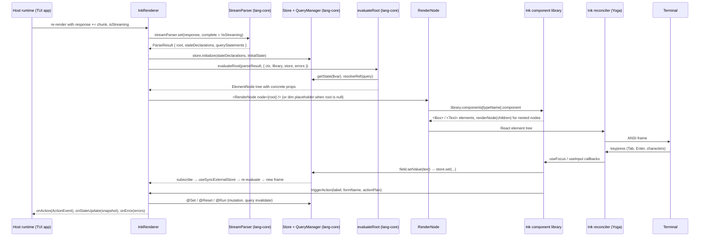

# @openuidev/ink-lang

Terminal (TUI) runtime for OpenUI Lang, built on [Ink](https://github.com/vadimdemedes/ink). It renders the same streamed OpenUI Lang programs as `@openuidev/react-lang`, with the same component names, positional arguments and schemas, so one system prompt serves a web app and a terminal app.

[](https://github.com/thesysdev/openui/blob/main/LICENSE)

**Links:** [OpenUI Lang docs](https://openui.com/docs/openui-lang) | [GitHub repo](https://github.com/thesysdev/openui)

## Install

```bash
npm install @openuidev/ink-lang ink react zod
# or
pnpm add @openuidev/ink-lang ink react zod
```

**Peer dependencies:** `ink ^8.0.0`, `react >=19.3.0`, `zod ^3.25.0 || ^4.0.0`. Node 22 or newer. The package is ESM only, like Ink.

## Overview

1. **Render streamed output** with `<InkRenderer>` inside your Ink app as the OpenUI Lang arrives.
2. **Use the default terminal library** (`inkLibrary`) whose components mirror the React default library, or **define your own** Ink components with `defineComponent` and `createLibrary`.
3. **Receive actions and state** through `onAction` and `onStateUpdate`; the components never talk to your host directly.

## Quick start

```tsx
import { Box, render, Text } from "ink";
import { useEffect, useState } from "react";
import { InkRenderer, inkLibrary, type ActionEvent } from "@openuidev/ink-lang";

function App() {
  const [response, setResponse] = useState("");
  const [isStreaming, setIsStreaming] = useState(true);
  const [lastEvent, setLastEvent] = useState<ActionEvent | null>(null);

  useEffect(function stream() {
    // Append each chunk of the model's response, then flip isStreaming off at the end.
    void streamFromYourModel(setResponse).then(function done() {
      setIsStreaming(false);
    });
  }, []);

  return (
    <Box flexDirection="column">
      <InkRenderer
        response={response}
        library={inkLibrary}
        isStreaming={isStreaming}
        onAction={setLastEvent}
      />
      <Text dimColor>
        {lastEvent ? `${lastEvent.type}: ${lastEvent.humanFriendlyMessage}` : ""}
      </Text>
    </Box>
  );
}

render(<App />);
```

The system prompt comes from the library, exactly as with `react-lang`:

```ts
const systemPrompt = inkLibrary.prompt({ preamble: "You are a deployment assistant." });
```

The terminal library ships every component of the React default library with an identical schema, so one prompt serves both renderers. The parser drops components a custom library does not know and reports them through `onError` as `unknown-component` (or in the dim red error footer when no `onError` is passed), so the rest of the program still renders.

## Try it

```bash
pnpm --filter @openuidev/ink-lang demo
```

`examples/demo.tsx` streams a mock response chunk by chunk, logs every `onAction` event and the `onStateUpdate` snapshots under the rendered program. Tab and Shift+Tab move focus, Enter or Space presses a button, typing edits the field, Up and Down move through a Select, Esc quits. Add `--mouse` to click and scroll:

```bash
pnpm --filter @openuidev/ink-lang demo -- --mouse
```

The showcase is a full-screen tour of every component, one page per group, with the mouse on:

```bash
pnpm --filter @openuidev/ink-lang showcase
```

The theme line under the page list is a select of design systems (`examples/showcase/showcase-themes.ts`): the hand-made basics (Default, Bordered, Minimal, Midnight, Daylight, System and Monokai), seventeen themes inspired by well-known palettes (`examples/showcase/inspired-themes.ts`: Nord, Dracula, Gruvbox dark and light, Catppuccin latte and mocha, One Dark, Tokyo Night, Rosé Pine, GitHub light, Everforest, Kanagawa, a black-white-yellow High Contrast, a colorless Mono, an airy Paper, a Blueprint and a dense Terminal Green) and the VS Code built-in themes (`examples/showcase/vscode-themes.ts`: Dark+, Dark Modern, Light+, Light Modern, Monokai Dimmed, Solarized Dark and Light, Abyss, Kimbie Dark, Quiet Light, Red, Tomorrow Night Blue and the two High Contrast themes), read from the theme files of the vscode repository and the registry defaults. Together the themes assign every design token, and each inspired theme shows a customisation of its own (a grid, a spacing scale, a typography transform, a border shape, a stylesheet rule); `test/showcase/showcase-themes.test.ts` checks that, along with the contrast of text on the canvas. Ctrl+T cycles them, and the open list shows a window of eight with "more" hints. The sidebar, the theme select and the page share one `FocusScope`, whose `order` puts the sidebar, then the theme select, then the page in the Tab cycle; Left from the page lands on the sidebar and Down past the last page lands on the theme select; the page pane scrolls so the stop that takes focus stays in view.

The pages: Overview (card blocks, tags, buttons, QR codes in both sizes), Layout (Stack alignment, justification and gap words, the three Card variants, separators, images), Content (text sizes, markdown, code, icons, tooltips in all four placements and both variants, floating over the page pane, tags, text blocks, metrics), Charts (every chart with its variants), Forms (every input, validation, the button, select and icon button sizes), Selection (chips and option cards), Data (a paged table with string, number and action columns, entity list, list blocks, an editable table), Navigation (tabs, accordion, steps, carousel), Card blocks, Feedback (callouts, modal, queries with retry, a mutation), Dialogs (confirm, info, warning, form and choice dialogs), Design tokens (a `TokenSheet` of the active theme marking the tokens it sets, then a `Theme(...)` declared by the program), Stylesheet (one `Theme(...)` whose stylesheet uses every property and selector form of the CSS subset) and Chat app (a product screen laid out like a chat application, with its own component library and design system: a chat list with search, filter chips and contact rows, a conversation with date dividers, bubbles, a reply quote, an attachment, a typing indicator and a composer). `test/showcase/pages.test.tsx` checks that, together, the pages use every component, every enum value of every schema, every CSS property and every selector feature. `examples/showcase.tsx` takes the alternate screen and renders `examples/showcase/showcase-app.tsx`: a sidebar of pages on the left (Up and Down, a click or the wheel pick one; Ctrl+N and Ctrl+P work from anywhere), the active page streaming into `InkRenderer` on the right (PgUp, PgDn and the wheel scroll it), an event log of the UI events and a status bar with the last `onAction` event and `onStateUpdate` snapshot. Every page is an OpenUI Lang program under `examples/showcase/programs/`. The Feedback page's queries and mutation are served by `examples/showcase/showcase-tools.ts`, whose `health` tool fails on its first call so the retry control shows. Ctrl+Q quits; `--no-mouse` keeps the terminal's own text selection.

## `InkRenderer` props

| Prop            | Type                                                          | Description                                                                                                                                                                          |
| :-------------- | :------------------------------------------------------------ | :----------------------------------------------------------------------------------------------------------------------------------------------------------------------------------- |
| `response`      | `string \| null`                                              | The accumulated OpenUI Lang text, or a stored message with `]]>openui:` markers                                                                                                      |
| `library`       | `Library`                                                     | A library from `createLibrary()`; `inkLibrary` is the default                                                                                                                        |
| `isStreaming`   | `boolean`                                                     | True while the model is still producing the program: buttons and inputs are inactive, queries wait, errors are held back                                                             |
| `onAction`      | `(event: ActionEvent) => void`                                | Button presses and custom actions, after `@Set`, `@Reset` and `@Run` steps have run                                                                                                  |
| `onStateUpdate` | `(state: Record<string, unknown>) => void`                    | The store snapshot after each user edit (never for declared defaults)                                                                                                                |
| `initialState`  | `Record<string, unknown>`                                     | State to restore: `$`-prefixed keys are bindings, other keys are form state                                                                                                          |
| `onParseResult` | `(result: ParseResult \| null) => void`                       | The raw parse result whenever it changes                                                                                                                                             |
| `toolProvider`  | `Record<string, (args) => Promise<unknown>> \| McpClientLike` | Serves `Query()` and `Mutation()` calls once streaming ends                                                                                                                          |
| `onError`       | `(errors: OpenUIError[]) => void`                             | Structured errors once streaming ends, `[]` when a new stream starts. Without it, errors are drawn as a red footer in the UI                                                         |
| `theme`         | `InkThemeOverrides`                                           | The palette (`accent`, `danger`, `muted`, `success`, `warning`) and the CSS-like style slots (`field`, `button`, `card`, `heading`, `subtext`, `focusRing`); see [Theming](#theming) |
| `mouse`         | `boolean \| { motion?: boolean }`                             | Turns terminal mouse reporting on (see [Mouse](#mouse)); `{ motion: false }` skips hover tracking                                                                                    |
| `onUiEvent`     | `(event: UiEvent) => void`                                    | Browser-like events of every component: focus, blur, keydown, keyup, input, change and the mouse events (see [UI events](#ui-events))                                                |
| `designSystem`  | `DesignSystemInput`                                           | Design tokens, a stylesheet of the CSS subset and a light/dark/system mode; see [Design systems](#design-systems)                                                                    |

While `isStreaming` is true and the root has not appeared yet, a dim `…` placeholder is drawn; a dim `streaming…` line sits under the tree until the stream ends, and `loading…` while a query is in flight.

## Components

Every component keeps the name, positional argument order, Zod schema and description of its `@openuidev/react-ui` counterpart; a test compares them with the generated spec of the React default library.

| Component                                                                                            | Signature                                                                                              | Terminal rendering                                                                                                                                                                                                          |
| :--------------------------------------------------------------------------------------------------- | :----------------------------------------------------------------------------------------------------- | :-------------------------------------------------------------------------------------------------------------------------------------------------------------------------------------------------------------------------- |
| `Stack`                                                                                              | `Stack(children, direction?, gap?, align?, justify?, wrap?)`                                           | Ink `Box`; gap tokens become 0 to 3 cells                                                                                                                                                                                   |
| `Card`                                                                                               | `Card(children, variant?, direction?, gap?, align?, justify?, wrap?)`                                  | Round border (`card`), single dim border (`sunk`), no border (`clear`)                                                                                                                                                      |
| `CardHeader`                                                                                         | `CardHeader(title?, subtitle?)`                                                                        | Title and subtitle lines dressed by `CardHeader .title` and `.subtitle` (the `h4` and `helper` typography tokens: weight, transform, color)                                                                                 |
| `TextContent`                                                                                        | `TextContent(text, size?)`                                                                             | Markdown (headings, lists, bold, italic, code, links); `small` dim, `small-heavy` bold dim, `large` bold, `large-heavy` bold underlined                                                                                     |
| `Button`                                                                                             | `Button(label, action?, variant?, type?, size?)`                                                       | `[ label ]`; primary bold, secondary and tertiary plain, destructive in the error color; the focus look comes from the cascade (`Button:focus`)                                                                             |
| `Buttons`                                                                                            | `Buttons(buttons, direction?)`                                                                         | Row (default) or column of buttons                                                                                                                                                                                          |
| `Input`                                                                                              | `Input(name, placeholder?, type?, rules?, value?)`                                                     | One-line editor with a block cursor while focused; `password` masks the value; the field box follows `shape.fieldBorder`                                                                                                    |
| `Theme`                                                                                              | `Theme(tokens, css?, children)`                                                                        | Applies a design system (tokens plus a CSS-subset stylesheet) to its children; terminal only                                                                                                                                |
| `Tooltip`                                                                                            | `Tooltip(trigger, text, placement?, variant?)`                                                         | Shows the text in a bubble floating over the program beside the trigger while it is focused or hovered, without moving the layout (a one-row label when the program is too short; see [Overlays](#overlays)); terminal only |
| `QrCode`                                                                                             | `QrCode(data, size?)`                                                                                  | A scannable QR code in block characters (`compact` half blocks or `large`); terminal only                                                                                                                                   |
| `ModalDialog`                                                                                        | `ModalDialog(variant, title, body, cancelLabel?, confirmLabel?, open?, confirmAction?, cancelAction?)` | A confirm, info, warning or destructive dialog that blocks everything behind it; terminal only                                                                                                                              |
| `Select`                                                                                             | `Select(name, items, placeholder?, rules?, value?, size?)`                                             | Shows the picked label (or the placeholder); focused it opens the list, Up and Down move, Enter or Space pick                                                                                                               |
| `Combobox`                                                                                           | `Combobox(name, items, placeholder?, rules?, value?, size?)`                                           | A Select with a typed filter: a `> filter` line and up to five matches; terminal only                                                                                                                                       |
| `SelectItem`                                                                                         | `SelectItem(value, label)`                                                                             | One option of a Select or Combobox (not drawn on its own)                                                                                                                                                                   |
| `Form`                                                                                               | `Form(name, buttons, fields?)`                                                                         | Scopes its fields under the form name and owns their validation; draws the fields, then the buttons                                                                                                                         |
| `FormControl`                                                                                        | `FormControl(label, input, hint?)`                                                                     | Bold label (`*` when required), the input, the dim hint or the red validation error                                                                                                                                         |
| `Label`                                                                                              | `Label(text)`                                                                                          | Plain text                                                                                                                                                                                                                  |
| `Table`                                                                                              | `Table(columns)`                                                                                       | Column-oriented: header, rule and ten rows per page with a `[ prev ] [ next ]` pager; element cells get a column wide enough for their text; `thead`, `tbody`, `tr`, `th` and `td` in the stylesheet                        |
| `Col`                                                                                                | `Col(label, data, type?)`                                                                              | One column of a Table: `data` is one value or component per row (not drawn on its own)                                                                                                                                      |
| `Tabs`                                                                                               | `Tabs(items)`                                                                                          | A focusable strip of the `trigger` labels (Left and Right move) above the active tab's content                                                                                                                              |
| `TabItem`                                                                                            | `TabItem(value, trigger, content)`                                                                     | One tab of a Tabs strip (not drawn on its own)                                                                                                                                                                              |
| `BarChart`, `HorizontalBarChart`, `RadarChart`                                                       | `BarChart(labels, series, variant?, xLabel?, yLabel?, height?)` and friends                            | One text bar per label and series with the value; `Series(category, values)` carries the numbers                                                                                                                            |
| `LineChart`, `AreaChart`                                                                             | `LineChart(labels, series, variant?, xLabel?, yLabel?, height?)`                                       | One braille polyline per series on a shared canvas (AreaChart fills under the lines), the value range on the y axis, the first and last label, a legend line per series                                                     |
| `PieChart`, `RadialChart`, `SingleStackedBarChart`                                                   | `PieChart(labels, values, variant?, appearance?)` and friends                                          | A colored proportion bar and a legend with percentages                                                                                                                                                                      |
| `ScatterChart`                                                                                       | `ScatterChart(datasets, xLabel?, yLabel?)`                                                             | Every dataset's points on one braille canvas with the x and y ranges and a legend line per `ScatterSeries(name, points)` with its point count                                                                               |
| `TextArea`                                                                                           | `TextArea(name, placeholder?, rows?, rules?, value?)`                                                  | Multi-line editor padded to `rows` lines; Enter inserts a newline, Up and Down move between lines                                                                                                                           |
| `CheckBoxGroup`, `CheckBoxItem`                                                                      | `CheckBoxGroup(name, items, rules?, value?)`                                                           | `[x] label` per item with a dim description; one focus stop, Up and Down move, Space toggles; stores `{ itemName: boolean }`                                                                                                |
| `RadioGroup`, `RadioItem`                                                                            | `RadioGroup(name, items, defaultValue?, rules?, value?)`                                               | `(•) label` per item; one focus stop, Up and Down move, Space picks; stores the value                                                                                                                                       |
| `SwitchGroup`, `SwitchItem`                                                                          | `SwitchGroup(name, items, variant?, value?)`                                                           | `[on ]` / `[off]` per item, optional card or sunk border; stores `{ itemName: boolean }`                                                                                                                                    |
| `Slider`                                                                                             | `Slider(name, variant, min, max, step?, defaultValue?, label?, rules?, value?)`                        | `├━━●──┤ value` track; Left and Right move by `step` (default 1); stores `[value]`                                                                                                                                          |
| `DatePicker`                                                                                         | `DatePicker(name, mode?, rules?, value?)`                                                              | `YYYY-MM-DD` (or `from to to` in range mode); Left and Right pick the segment, Up and Down change it; stores an ISO string                                                                                                  |
| `Chips`, `ChipItem`                                                                                  | `Chips(name, type?, items?, rules?, defaultValue?)`                                                    | Row of `[ label ]` chips, `[✓ label]` when selected; one focus stop, arrows move, Space toggles; stores a value or a list                                                                                                   |
| `OptionCards`, `OptionCard`                                                                          | `OptionCards(name, type?, items?, rules?, defaultValue?)`                                              | Column of bordered cards (accent when selected) with the icon or image placeholder, title and subtitle; same keys as Chips                                                                                                  |
| `EditableTable`                                                                                      | `EditableTable(name?, columns?, data?)`                                                                | Header, rule and one focusable cell per value; Tab moves between cells, select cells cycle with Up and Down; stores the edited rows                                                                                         |
| `Accordion`, `AccordionItem`                                                                         | `Accordion(items)`                                                                                     | `▸ trigger` headers, one focus stop each; Enter or Space opens (`▾`) and closes the section                                                                                                                                 |
| `Steps`, `StepsItem`                                                                                 | `Steps(items)`                                                                                         | `1. Title` in bold with the dim details under it                                                                                                                                                                            |
| `Carousel`                                                                                           | `Carousel(children, variant?)`                                                                         | One item visible under a focusable `◂ n / total ▸` line; Left and Right move                                                                                                                                                |
| `Separator`                                                                                          | `Separator(orientation?, decorative?)`                                                                 | A dim rule across the available width (or a `│` column in a row)                                                                                                                                                            |
| `Modal`                                                                                              | `Modal(title, open?, children, size?)`                                                                 | Accent-bordered box with the bold title and a focusable `[ x ]`, drawn while `$open` is true; closing sets it to false                                                                                                      |
| `Callout`, `TextCallout`                                                                             | `Callout(variant, title, description, visible?)`                                                       | Left border in the variant color, bold title, description; a bound `$visible` hides it and auto-dismisses after 3s                                                                                                          |
| `Tag`, `TagBlock`                                                                                    | `Tag(text, icon?, size?, variant?)`, `TagBlock(tags, size?)`                                           | `[text]` in the variant color; TagBlock is a wrapping row of them                                                                                                                                                           |
| `Icon`                                                                                               | `Icon(name, category?)`                                                                                | The icon name in angle brackets, dim: `<rocket>`                                                                                                                                                                            |
| `IconButton`                                                                                         | `IconButton(name, icon, action?, variant?, size?, shape?)`                                             | `[ <icon> name ]`, focusable like a Button                                                                                                                                                                                  |
| `Image`, `ImageBlock`, `ImageGallery`                                                                | `Image(alt, src?)`, `ImageBlock(src, alt?)`, `ImageGallery(images)`                                    | A dim `▣ alt` placeholder line per image (the url when there is no alt); nothing is fetched                                                                                                                                 |
| `CodeBlock`                                                                                          | `CodeBlock(language, codeString)`                                                                      | Single-line box with the dim language label and the code as written                                                                                                                                                         |
| `MarkDownRenderer`                                                                                   | `MarkDownRenderer(textMarkdown, variant?)`                                                             | The same markdown subset as TextContent, in a card or sunk border when asked                                                                                                                                                |
| `InlineHeader`                                                                                       | `InlineHeader(heading, description?)`                                                                  | Bold heading and dim description                                                                                                                                                                                            |
| `EntityList`                                                                                         | `EntityList(rows?, size?, header?, footer?)`                                                           | Two aligned columns, numbers right-aligned, bold header, footer under a rule                                                                                                                                                |
| `ListBlock`, `ListItem`                                                                              | `ListBlock(items, variant?, size?)`                                                                    | `1. title` (or `▣ title`) with a dim subtitle; items with an action are focus stops that fire it on Enter                                                                                                                   |
| `Text`, `BoldText`                                                                                   | `Text(variant?, value, subtext?, subtextVariant?, size?)`                                              | The value line and a dim subtext line (`metric` subtexts green or red by sign)                                                                                                                                              |
| `IconText`, `ImageText`, `ImageTextLarge`                                                            | `IconText(icon, iconVariant?, iconSize?, title, subtitle?, bold?, layout?)`                            | `<icon> title` / `▣ title` with a dim subtitle; the large variant puts the placeholder line above a bold title                                                                                                              |
| `MetricIndicatorInline`, `MetricIndicatorWithStrikethrough`                                          | `MetricIndicatorInline(value, subtext?, trend?)`                                                       | `value  +12%  subtext`; the strikethrough variant strikes the previous value and puts the subtext below                                                                                                                     |
| `SnippetCardBlock`, `OverviewCardBlock`, `ContextCardBlock`, `CompositeCardBlock`, `VisualCardBlock` | `SnippetCardBlock(items, layout?, responsive?, action?, gap?)` and friends                             | One dim bordered text block per `*CardItem`; with an `action` every card is a focus stop and Enter fires it with the item context                                                                                           |

Every schema, child union included, is identical to react-ui's; the parity test compares them byte for byte. The one exception is `Combobox`, which has no react-ui counterpart: it takes Select's schema and the parity test checks that, and `FormControl.input` lists it in addition to react-ui's members.

Keyboard: Tab and Shift+Tab move between focus stops in the program's order (from `root` down, each component visiting its children in the order it lays them out; see [Focus order](#focus-order)): buttons, inputs, selects, comboboxes, option groups, tab strips, accordion headers, carousels, table cells, table pagers and pressable cards. Enter or Space presses the focused button, toggles the option under the cursor or opens a section. In a focused text field, printable keys insert, Backspace and Delete remove, Left, Right, Home and End move the cursor; in a TextArea Enter inserts a newline and Up and Down move between lines. Up and Down (or Left and Right) move inside a group; Left and Right move a Slider by its step, switch tabs or carousel items and pick a DatePicker segment, which Up and Down change. While a query is loading a spinner line shows under the program, and a failed query leaves a focusable `[ retry ]` that re-runs it. A focused Tooltip trigger shows its bubble floating over the program, as hovering it does. In a focused Combobox, typing filters the options, Up and Down move the highlight, Enter picks and Escape clears the filter and drops focus, as Escape does on any stop. The `[ prev ]` and `[ next ]` controls under a long table turn its pages. The arrow keys move focus between components by their position on screen (Left and Right along the row, Up and Down across rows) whenever the focused component does not use that arrow itself, or has nowhere further to go with it: a Slider keeps Left and Right until it reaches its minimum or maximum, a Select keeps Up and Down until its first or last option, a text field keeps Left while the cursor can still move left and Right while it can still move right, so Left at the start of the text (or Down on the last option card) moves focus to the neighbour instead. With `mouse` on, clicks, hover and the wheel work as well (see [Mouse](#mouse)).

### Focus order

The Tab order of a program follows its tree from `root` down, and each component decides the order of its own children. A component gets a fresh `renderNode` on every render, and that `renderNode` numbers the elements it renders: the first one takes order 0, the next order 1, the items of an array the next orders in turn, and `renderNode(node, { order })` gives one element an explicit order. The program's rank followed by the orders from `root` down to an element are its sequence path (`[0, 0, 1, 0]`, read with `useSequencePath()`). The rank is 0 for a standalone renderer; inside a `FocusScope` each `InkRenderer` takes the next rank when it first renders, so every stop of one program comes before the next program's. A component with stops of its own (a table's cells, a card block's cards, a modal's close control) gives each one an order with `useFocusable({ order })`: the stop's path is its element's path plus that order (default 0; `ORDER_LAST` comes after all of the element's children), so a stop comes before everything its element renders at the same order. A component that draws one stop per item with the item's content right after it wraps each item's content in `<SequenceLevel order={...}>`, one level below the item's order, so the content comes after the item's stop and before the next item (accordion sections, pressable cards and the renderer's query status do). Children that are not rendered (inactive tabs, closed sections, other carousel items, a closed modal) have no stops, so the order depends only on the tree and on what is rendered, never on mount timing within a program (renderers in one scope rank in the order they first render, the program rank), terminal width or scrolling.

A custom container orders its children the same way, through the `renderNode` prop its renderer receives: direct `renderNode` calls are numbered in call order, so call it in the order the children are laid out, and `renderNode(value, { order })` overrides the order of one. A sub-component that renders the content of one item (a section body under its header, say) wraps that content in `<SequenceLevel order={index}>` and draws it with `renderValue`, as `Accordion` does, so it sits one level under the item's order. Do not hand `renderNode` itself to a sub-component: it keeps counting across the sub-component's own re-renders. An element drawn with `renderValue` takes order 0, so two of them under one level tie and their stops fall back to mount order.

Every focus stop registers a `FocusEntry` in a focus registry: its box on screen, its component type and name, the arrows it keeps for itself right now and its `path`, the sequence path (`null` for a stop outside a renderer). `path` is a required field, so code that registers entries by hand must set it. `focusOrder(registry)` returns the programs' active stops sorted by sequence path (`compareSequencePath`), each with `id`, `component`, `name`, `program` (its renderer's rank, the first number of the path), `path`, `rect` and `arrows: { up, down, left, right }`; `hostStops(registry)` returns the active stops outside the renderers in registration order; `nextInOrder(stops, activeId, delta)` is the Tab step itself.

The library owns Tab, Shift+Tab, Escape and `autoFocus`: `FocusNavigator` switches Ink's own focus handling off while it is mounted (Ink's `focus(id)` keeps working), so Ink never moves focus first, and switches it back on when it unmounts, so plain Ink `useFocus` UI the host shows once the renderer is gone moves with Ink's Tab again. Several standalone renderers (without a `FocusScope`) each switch Ink's single global focus flag, so an app with more than one renderer should wrap them in one `FocusScope`. Escape drops focus, and the first stop that asks for `autoFocus` takes focus when it mounts, and a later one only while no stop has focus. A component that moves focus itself calls `useFocusCommands()` (`focusFirst`, `focusNext`, `focusPrevious`), which follow the same cycle.

The renderer owns one registry, one modal layer stack and one navigator unless a `FocusScope` above it does, in which case the host's own stops and the program's share one Tab cycle, one arrow map and one modal layer stack: wrap the app in `<FocusScope onUiEvent={...} order={...}>`, build the host's panels with `useFocusable` (with `component`, `name`, `autoFocus` and edge-aware `arrows` claims), and Left from the first column of a page lands on the sidebar beside it, Down past the last page of that sidebar lands on the panel under it. `order(program, host)` receives the program's stops in Tab order and the host's stops in registration order (only the ones that can take focus right now) and returns the ids of the full cycle; it is asked on every Tab, ids it returns that are not among the stops it was given are skipped, and an id it returns twice keeps its first place. A stop the function leaves out, a host stop included, is unreachable by Tab and Shift+Tab (the arrows and the mouse still reach it). The default, `defaultCycle`, puts the host's stops first, then the program's. Host stops have no sequence path, so wherever they render they never land inside the program's sequence. The modal layers belong to the scope: while a program's modal is open the host's stops are inert too, and the cycle holds the modal's own stops only.

```tsx
function sidebarFirst(program: FocusStop[], host: FocusEntry[]): string[] {
  const ids: string[] = [];
  for (const entry of host) if (entry.component === "Sidebar") ids.push(entry.id);
  for (const stop of program) ids.push(stop.id);
  return ids;
}

<FocusScope order={sidebarFirst}>
  <Sidebar />
  <InkRenderer response={response} />
</FocusScope>;
```

The rules, in order:

| Key                           | Rule                                                                                                                                                                                                     |
| ----------------------------- | -------------------------------------------------------------------------------------------------------------------------------------------------------------------------------------------------------- |
| Tab, Shift+Tab                | Next or previous stop of the cycle (the scope's `order`, by default the host's stops, then the program's by sequence path), wrapping around.                                                             |
| Escape                        | Drops focus (a focused Combobox also clears its filter).                                                                                                                                                 |
| Arrow the focused stop claims | Handled by the component (cursor, option, segment, value). A claim is asked at key time, so it ends at the edge: last option, end of the text, maximum value.                                            |
| Arrow nobody claims           | Nearest stop in that direction: Left and Right prefer a stop on the same row and fall back to the nearest one off the row; Up and Down take the nearest stop above or below, preferring the same column. |
| Mouse                         | A left press on a stop focuses it; a stop with `hoverFocus` focuses on hover.                                                                                                                            |
| Modal open                    | Only the stops inside the top modal layer are active; the others, the host's stops of the same `FocusScope` included, leave the registry's active set until it closes.                                   |

## Overlays

Some content floats over the program instead of taking cells in its layout: today the `Tooltip` bubble; dialogs and modals move onto the same layer in later steps. An overlay overwrites the cells under it without moving anything else, and closing it gives them back.

**The host.** An overlay joins the nearest overlay registry and is painted by that registry's `OverlayHost`, which renders after everything else in its subtree. A `FocusScope` hosts the overlays of the whole app (the host's own panels and every `InkRenderer` inside it) after its children, so a bubble whose trigger sits in a scrolled pane (a `Box` with `overflowY="hidden"` and `contentOffsetY`) is not clipped at the pane's edge and may cover its border. A standalone `InkRenderer` hosts its own overlays at the end of its page and keeps them inside the page's cells: anything the host application renders after the renderer (a footer, a panel beside it) is painted later and would cover a bubble that strayed onto it, so a bubble there flips or turns compact inside the renderer instead. Floating over host UI requires a `FocusScope`. `OverlayHost` (with an optional `boundsRef`, the box overlays must stay inside; default the ink root) and `OverlayRegistryContext` are exported for an application that wants to paint overlays in a place of its own. An overlay whose anchor is scrolled out of an ancestor that hides its overflow (`overflow`, `overflowX` or `overflowY` set to `"hidden"`) is not drawn until the anchor scrolls back into view (`clippedBy` in `src/overlay/clip-rect.ts`).

**Contexts.** The host renders an overlay's content with the contexts of the component that opened it (`useCapturedContexts` and `BridgedContexts`): the runtime, the theme and design system, the UI event listener, the focus registry and commands, the modal layers, the element and sequence paths, the form, the mouse provider, the program rank and the scope's cycle. So a Button inside an overlay fires the owning program's actions and takes the owning theme's styles. Contexts of your own are not bridged: read them in the owning component and close over the values in `render`.

**Stacking and the mouse.** Overlays stack in the order they open, later ones on top. Each one paints in a mouse layer of its own above the page (`MouseLayerContext`, its stacking index plus one), and a target in a higher layer wins the hit-test whatever its depth in the tree. An overlay's box takes the presses, releases and clicks on its cells, so they never reach what it covers; moves and the wheel pass through, so a hover tooltip closes when the pointer leaves its trigger (even onto its own bubble) and a pane under a bubble still scrolls.

**Placement.** `placement` is `top`, `bottom`, `left`, `right` or `center`, with `gap` empty cells between the anchor and the overlay. The bounds are the ink root (the cells Ink draws) for a `FocusScope`'s host and the page for a standalone renderer's host. The rules, in order:

| Case                                 | Rule                                                                                                                                                                     |
| ------------------------------------ | ------------------------------------------------------------------------------------------------------------------------------------------------------------------------ |
| The asked side fits                  | The overlay goes on that side of its anchor.                                                                                                                             |
| Only the opposite side fits          | It flips to the opposite side.                                                                                                                                           |
| Placed on a side                     | It is then shifted (never shrunk) to lie inside the bounds: a bubble past the right edge moves left, a side bubble beside the last row moves up.                         |
| `top` or `bottom`, neither side fits | It takes the side with more room (the asked one on a tie), never covers its anchor, and the rows past the bounds are cut (Ink draws no rows outside the root).           |
| `left` or `right`, neither side fits | It is shifted inside the bounds anyway, since a row longer than the terminal would wrap, so in a narrow terminal it may cover its trigger, unless it has a compact form. |
| `center`                             | Centred in the bounds.                                                                                                                                                   |

**Width.** An overlay's box is never wider than its bounds (`maxWidth`), so long content wraps inside the terminal: a line past the terminal's edge would be wrapped by the terminal itself and break Ink's count of the lines it drew. A 200-character tooltip in a 60-column terminal is a bubble at most 60 cells wide over several rows.

**Compact form.** `renderCompact` gives a one-row form of the content, drawn instead of `render()` when the whole box does not fit: a `top` or `bottom` overlay that fits neither above nor below its anchor, or a `left` or `right` one taller than the bounds or with no room beside its anchor on either side. The compact form is limited to the wider room beside its anchor on the anchor's row (`compactWidthLimit`; the bounds' width when neither side holds eight cells), so a long label is truncated there (the Tooltip's ends in an ellipsis). It goes one cell right of the anchor on its row, else one cell left of it, else under it (over it on the last row), so it never covers the anchor. The Tooltip's compact form is its text on one row. While the compact form shows, the whole content stays measured (see Measuring), and it is drawn again as soon as it fits: after the terminal widens or the root grows.

**Opacity and background.** `opaque` (default `true`) paints blank cells under the box before its content: a terminal has no transparency and Ink writes only text and borders, so without them the base shows through padding and short lines. An opaque overlay is painted with the background its anchor sits on, the nearest `backgroundColor` on the anchor or its ancestors (`anchorBackground`), and its content inherits it, as it would in the anchor's place: Ink's own inherited background does not reach a host rendered elsewhere in the tree, so a bubble over a themed canvas would otherwise be a hole in the terminal's default colour. Content that sets its own background keeps it. With `opaque: false` the base shows through the empty cells and no background is painted; presses and clicks on the box are absorbed all the same.

**Measuring.** The host measures each anchor and overlay after every render of its own and after every layout of the ink root: it follows Ink's per-commit layout notification, the one Ink's `useBoxMetrics` uses (`useLayoutSignal`), so a bubble follows its trigger when a pane scrolls by state of its own, a sibling grows or the terminal is resized, though neither the owner nor the host re-rendered. It re-renders only when a placement changed. A form is first drawn below the root's last row, which Ink does not output, measured there and then shown in place, so no frame shows an overlay where it does not belong (over its trigger); the same happens to a form whose width limit changed. While the compact form shows, the whole content stays mounted below the root and is measured on every layout. Placements come from the layout Ink has just computed, so an overlay follows a moved anchor one frame later.

**Custom components** float content with `useOverlay(options)`, which returns `{ id }`. `kind` is `"tooltip"`, `"dialog"` or `"modal"`; `anchorRef` is the `Box` the overlay is placed against; `placement`, `gap` (default 0), `renderCompact` and `opaque` (default `true`) are as above. The overlay is registered while `isOpen` is true and re-sent to the host after every render of the component, so its content stays current. `render` and `renderCompact` run inside the host, not in your component: they must not call hooks, so read everything they need in the component and close over it. They may run while nothing shows: the host mounts a form below the root to measure it before it shows it. Outside any registry the hook does nothing.

```tsx
import { Box, Text } from "ink";
import type { ReactNode } from "react";
import { useFocusable, useOverlay } from "@openuidev/ink-lang";

function HelpMark({ help }: { help: string }) {
  const focusable = useFocusable({ isActive: true, name: "help" });
  function renderHelp(): ReactNode {
    return (
      <Box borderStyle="round" paddingX={1}>
        <Text>{help}</Text>
      </Box>
    );
  }
  function renderHelpLabel(): ReactNode {
    return <Text wrap="truncate">{help}</Text>;
  }
  useOverlay({
    kind: "tooltip",
    anchorRef: focusable.ref,
    placement: "bottom",
    isOpen: focusable.isFocused || focusable.isHovered,
    render: renderHelp,
    renderCompact: renderHelpLabel,
  });
  return (
    <Box ref={focusable.ref}>
      <Text inverse={focusable.isFocused}>[?]</Text>
    </Box>
  );
}
```

## Mouse

Mouse support is off by default. Pass `mouse: true` to `InkRenderer` and render your app on the alternate screen, so Ink's layout cells line up with the terminal's:

```tsx
render(<App />, { alternateScreen: true });
// inside App:
<InkRenderer response={response} library={inkLibrary} mouse />;
```

While mounted, the renderer asks the terminal to report the mouse (xterm modes 1000, 1002, 1003 and SGR 1006) and turns the reporting off again when it unmounts or the process exits. Nothing else changes: the keyboard keeps working, and a program rendered without `mouse` never sees a mouse event.

Every focus stop (buttons, fields, selects, groups, cells, headers, cards) takes focus on a left press, like a control in a browser. On top of that:

| Component  | Click                                                | Hover                                            | Wheel                                      |
| :--------- | :--------------------------------------------------- | :----------------------------------------------- | :----------------------------------------- |
| `Button`   | Presses it, exactly like Enter (validation included) | Focuses it, so the focus ring is the hover style | -                                          |
| `Tabs`     | Selects and focuses the tab under the pointer        | -                                                | Over the strip: previous or next tab       |
| `Select`   | Opens it; a click on an option picks it              | -                                                | Moves the highlight (opens the list first) |
| `Input`    | Focuses the field                                    | -                                                | -                                          |
| `Combobox` | Opens it; a click on a match picks it                | -                                                | Moves the highlight (opens the list first) |
| `Table`    | `[ prev ]` and `[ next ]` turn the page              | -                                                | Over the table: previous or next page      |

Everything stays inert while `isStreaming` is true, as with the keyboard.

Custom components get the same events through `useMouse(ref, handlers)`, where `ref` points at a `Box`:

```tsx
import { Box, Text, type DOMElement } from "ink";
import { useRef, useState } from "react";
import { useMouse } from "@openuidev/ink-lang";

function Counter() {
  const ref = useRef<DOMElement | null>(null);
  const [count, setCount] = useState(0);
  useMouse(ref, {
    onClick: () => setCount(count + 1),
    onWheel: (event) => setCount(count + (event.direction === "up" ? event.ticks : -event.ticks)),
  });
  return (
    <Box ref={ref}>
      <Text>{count}</Text>
    </Box>
  );
}
```

Handlers: `onMouseDown`, `onMouseUp`, `onClick` (left press and release on the same box), `onDoubleClick` (a second click on the same box within 400 ms), `onContextMenu` (right release), `onMouseMove`, `onMouseEnter` and `onMouseLeave` (derived from consecutive moves; need `motion`), and `onWheel`. Each event carries the 0-based cell (`x`, `y`), the button and the `shift`, `alt` and `ctrl` flags. `onWheel` gets `direction` (`up`, `down`, `left`, `right`) and `ticks`: the wheel ticks that arrived in the same event-loop turn are coalesced into one call, so a trackpad fling does not cause a render per tick. An event goes to the innermost box under the pointer; if that box has no handler for it, the nearest enclosing box that has one gets it, so a tab trigger can take clicks while the strip around it takes the wheel. Enter and leave track the innermost box only. An open overlay wins the hit-test over the cells it covers and takes their presses and clicks; moves and the wheel pass through it (see [Overlays](#overlays)). While the left button is held, the box it was pressed on captures the moves and the release, so a drag that leaves the box keeps reaching it.

Terminal support: iTerm2, kitty, WezTerm, Ghostty, Alacritty and Windows Terminal all speak SGR mouse reporting. Under tmux, `set -g mouse on` is required, or tmux keeps the events for itself. The VS Code terminal and most others based on xterm.js work too.

Text selection: while mouse reporting is on, the terminal hands clicks and drags to the app instead of selecting text. Hold Shift (Option on some macOS terminals) while dragging to select text the usual way, or run without `mouse`.

## Defining your own components

```tsx
import { Text } from "ink";
import { z } from "zod/v4";
import {
  createLibrary,
  defineComponent,
  Stack,
  type ComponentRenderProps,
} from "@openuidev/ink-lang";

const GreetingSchema = z.object({
  name: z.string(),
  mood: z.enum(["happy", "excited"]).optional(),
});

function GreetingRenderer({ props }: ComponentRenderProps<z.infer<typeof GreetingSchema>>) {
  return <Text bold={props.mood === "excited"}>Hello, {props.name}!</Text>;
}

export const Greeting = defineComponent({
  name: "Greeting",
  description: "Greets the user",
  props: GreetingSchema,
  component: GreetingRenderer,
});

export const library = createLibrary({ root: "Stack", components: [Stack, Greeting] });
```

Inside a renderer, `useTriggerAction()`, `useStateField(name, value)`, `useFormName()`, `useIsStreaming()` and `useIsQueryLoading()` give access to the runtime, and the `renderNode` prop draws nested values in Tab order (see [Focus order](#focus-order)). `useFocusable({ isActive })` registers the component with Ink's focus manager; `reactive(schema)` marks a prop as bindable with `$variables`. Primitive children are wrapped in `Text` automatically because Ink refuses bare strings outside `Text`.

## How a chunk becomes a frame



## Errors and streaming

- Nothing a model writes can crash the renderer: a parser crash becomes a `parse-exception` error, a component that throws is caught by an error boundary that keeps its last good frame and reports `render-error`, and a program that produced no statements reports `parse-failed`.
- Errors are collected only once `isStreaming` is false, so half-written programs never report `unknown-component` or `missing-required` by mistake.
- `onStateUpdate` fires once per user edit; `@Set` and `@Reset` steps count as edits.
- `ink-lang` never writes to the console. If you pass no `onError`, the errors are drawn under the program instead. (`lang-core` itself logs a failed query with `console.error`; Ink's `patchConsole` keeps that above the frame.)

## Telemetry

`ink-lang` sends nothing. It uses `createStreamingParser` and `library.prompt()` from `@openuidev/lang-core`, which are not instrumented. See the `lang-core` README for the flags that disable the rest of that package's telemetry.

## Validation

## Theming

A theme is a palette plus one style slot per part of the UI, so a design system's tokens map onto the terminal the way they map onto CSS. Every color takes any Ink value: a name (`cyan`), a hex code (`#38bdf8`) or `rgb(...)`.

| Slot        | Parts                                                | Shape                                                                                                                   |
| :---------- | :--------------------------------------------------- | :---------------------------------------------------------------------------------------------------------------------- |
| `field`     | Input, TextArea, Select, Combobox, DatePicker        | `box` (border, borderColor, borderDim, background, paddingX, paddingY), `text`, `placeholder`, `focused: { box, text }` |
| `button`    | Button, IconButton, the table pager, `[ retry ]`     | `primary`, `secondary`, `tertiary`, `destructive`, `focused`, `disabled` (text styles)                                  |
| `card`      | Card                                                 | `card`, `sunk`, `clear` (box styles)                                                                                    |
| `heading`   | CardHeader titles                                    | text style                                                                                                              |
| `subtext`   | Subtitles and hints                                  | text style                                                                                                              |
| `focusRing` | The option, row, tab, cell or value under the cursor | text style                                                                                                              |

A text style is `{ color, background, bold, dim, italic, underline, inverse, strikethrough }`; a box style is `{ border: "none" | "single" | "double" | "round" | "bold" | "classic", borderColor, borderDim, background, paddingX, paddingY }`. The defaults derive from the palette (a new `accent` recolors headings and card borders), and whatever the host passes is merged field by field over them:

```tsx
<InkRenderer
  response={response}
  library={inkLibrary}
  theme={{
    accent: "#38bdf8",
    field: {
      box: { border: "round", borderDim: true, paddingX: 1 },
      focused: { box: { borderDim: false, borderColor: "#38bdf8" }, text: { bold: true } },
    },
    focusRing: { inverse: false, background: "#334155" },
  }}
/>
```

`themePresets` ships four ready-made themes (`default`, `bordered`, `minimal`, `midnight`) that the showcase cycles with Ctrl+T; `resolveTheme(overrides)` returns the full `InkTheme`, and custom components read it with `useTheme()` and draw it with `boxProps` / `textProps` (or `FieldFrame` and `useFieldStyles` for a field).

## Design systems

`designSystem` takes a whole design system and derives every style from it, the way a web app derives its look from tokens and CSS:

```tsx
<InkRenderer
  response={response}
  library={inkLibrary}
  designSystem={{
    mode: "system",
    tokens: {
      "color.primary": "#2563eb",
      "color.canvas.surface": "#f1f5f9",
      "shape.fieldBorder": "round",
      light: { "color.text.value": "#0f172a" },
      dark: { "color.text.value": "#f8fafc" },
    },
    css: "Table tbody tr:odd { background-color: #e2e8f0 } Button:hover { background-color: var(--color-primary-100) }",
  }}
/>
```

**Tokens.** `color.primitive` holds the scales `primary`, `neutral`, `error`, `success`, `warning`, `info` and `canvas` (stops 100, 300, 500, 700, 900; one hex value becomes a scale, a named color fills every stop). `color.semantic` holds `canvas` (app, surface, disabled, content), `border` (default, hover, focus, error, success, disabled), `text` and `textBackground` (value, label, helper, placeholder, action, disabled, error, success), `button.background` and `button.text` (default, focus, hover, pressed, disabled) and `icon` (default, hover, pressed, disabled); the ones left empty follow the primitives or the terminal's own colors. `spacing` (xs, sm, md, lg, xl, in cells) sizes the Stack gap words; `grid` (columns, margin, gutter, containerMaxWidth) lays card blocks out in columns and bounds the root; `typography` (display, h1 to h6, body, label, helper: weight, italic, underline, transform, color) dresses headings (`h1` the large-heavy text and markdown `#`, `h2` and `h3` the next markdown levels, `h4` card titles, `h5` inline headers, `h6` small-heavy text), `display` large text, `body` default text, labels and helpers; `shape` (fieldBorder, cardBorder) picks the border styles. Write them as a nested object, as dotted paths (`"color.text.value"`), or as CSS variable names (`"--color-text-value"`); `mode` is `light`, `dark` or `system` (read from the terminal's `COLORFGBG`), and a `light` or `dark` block applies on top for that mode. Every token is also a CSS variable (`var(--color-primary-500)`, `var(--spacing-md)`) the stylesheet can read, and `createDesignSystem(input).assigned` lists the paths the input set itself (a whole primitive scale as one entry), which the showcase's token sheet marks.

**Stylesheet.** A subset of CSS: `Component`, `Component.variant` or `Component .part` (`Button.secondary`, `FormControl .label`, `Input::placeholder`), the states `:focus`, `:hover`, `:pressed`, `:disabled` and `:cursor` (the option under a group's cursor), descendants (`Form Button`, `Table tbody tr:odd td.number`) and `*`. Tables expose `thead`, `tbody`, `tr` (`:odd`, `:even`, `:first`, `:last`), `th` and `td` (`.number`, `.string`, `.col-N`), and the components inside a cell match `Table td Input`. Properties: `color`, `background-color`, `border`, `border-style`, `border-color`, `border-radius`, `outline` (drawn as the border), `padding` and its sides, `margin` and its sides, `gap`, `width`, `min-width`, `max-width`, `height`, `min-height`, `text-align`, `font-weight`, `font-style`, `font-size`, `font-family`, `text-decoration` (with a style and a color), `text-transform`, `opacity` (below 1 dims) and `filter: invert(1)` (inverse video). Lengths are cells, `px` (8 per cell) or `rem`/`em` (2 cells); colors are any Ink value plus the keywords `dim` and `inverse`. Rules cascade by specificity, then order: the default stylesheet derived from the tokens, then `css`, then the `theme` slots.

### What a terminal cannot do

Every property of the subset is accepted so a design system's stylesheet parses as written, but a terminal is a grid of cells with one font, so some of them degrade. The resolved value stays in the computed style (`fontSize`, `fontFamily`, `underlineStyle`, `underlineColor`) for a host that wants to act on it.

| Property                               | What happens                                                                          | Why                                                                                                                                                                        |
| :------------------------------------- | :------------------------------------------------------------------------------------ | :------------------------------------------------------------------------------------------------------------------------------------------------------------------------- |
| `font-size` above normal               | Renders bold                                                                          | Ink lays text out in 1 by 1 cells; only kitty can draw larger text (its text sizing protocol) and Ink would still measure one row, misaligning borders and columns         |
| `font-family`                          | Kept as a hint, nothing is sent                                                       | No terminal lets a program pick a font per element; only xterm and urxvt accept `OSC 50` to change the whole terminal's font, and the modern terminals do not implement it |
| `text-decoration` style and color      | A plain underline                                                                     | kitty, WezTerm, iTerm2 and Ghostty draw `SGR 4:3` (wavy) and `SGR 58` (color), but Ink 8 normalizes `4:n` to a plain underline and drops `58` before drawing               |
| `outline`                              | Drawn as the border                                                                   | There is no space outside a box to draw in                                                                                                                                 |
| `border-radius`                        | Picks `round` corners for any radius above zero, `single` for zero                    | Corners are glyphs, there is no radius in cells                                                                                                                            |
| `opacity` below 1                      | The dim attribute                                                                     | Terminals have no transparency                                                                                                                                             |
| `background-color` with hex or `rgb()` | Needs a truecolor terminal (all the ones above have it); named colors work everywhere | 24-bit colors are an escape the terminal must understand                                                                                                                   |
| Lengths in `px`, `rem`, `em`           | Converted at 8 px, 2 cells and 2 cells per unit                                       | An approximation of a typical cell size                                                                                                                                    |
| `text-align: center` and `right`       | Only where the component owns the line width (table cells)                            | Text in a column fills its own width                                                                                                                                       |
| `z-index`                              | Not part of the subset (reported as an unknown property)                              | Only overlays (tooltip bubbles) overlap the program, stacked in the order they open (see [Overlays](#overlays)); a stylesheet cannot reorder them                          |

**In programs.** A model or a product team can declare the same thing inside OpenUI Lang with the `Theme` component, which applies to its children only:

```
root = Theme({"color.primary": "#0f766e", "shape.fieldBorder": "round", mode: "dark"}, "ChatMessage.sent .bubble { background-color: #ccfbf1 }", [page])
```

**Custom components** read the cascade with `useComponentStyle(classes, states)` (the current component type and its ancestors are known) or `useStyleAs("Button", classes, states)` to style a part like another component, and draw it with `boxProps` / `textProps`. The `theme` slots still work and join the same cascade as rules.

## UI events

`onUiEvent` reports what happens inside the program with the names a browser would use, so a host can log, test or mirror the interaction:

| Type                                                                                                         | When                                                               | Extra fields                                                                    |
| :----------------------------------------------------------------------------------------------------------- | :----------------------------------------------------------------- | :------------------------------------------------------------------------------ |
| `focus`, `blur`                                                                                              | A component takes or loses focus (Tab, the arrows, a click)        |                                                                                 |
| `keydown`, `keyup`                                                                                           | Every key press; `keyup` only under the kitty keyboard protocol    | `key` (`Tab`, `Enter`, `ArrowUp`, `a`, `ctrl+n`...)                             |
| `input`                                                                                                      | A keystroke edits a text field or cell                             | `value`                                                                         |
| `change`                                                                                                     | A field value is stored (text, selection, slider, date, switch...) | `value`                                                                         |
| `mousedown`, `mouseup`, `click`, `dblclick`, `contextmenu`, `mouseenter`, `mouseleave`, `mousemove`, `wheel` | The mouse over a focusable component (`mouse` on)                  | `x`, `y`, `button`, `shift`, `alt`, `ctrl`; `direction` and `ticks` for `wheel` |

Every event carries `component` (the type name, `Button`, `Input`...) and `name` (the field name, label or trigger that identifies the instance). Custom components get the same reporting by building on `useFocusable` and `useStateField`; `useUiEvents()` returns the listener for anything else.

```tsx
<InkRenderer response={response} library={inkLibrary} onUiEvent={(event) => log.push(event)} />
```

The `rules` of every input (`{ required, email, url, numeric, min, max, minLength, maxLength, pattern }`) are checked when focus leaves the field, after an edit of a group, slider, date or selection, and before a primary `Button` fires a step that leaves the form (`@ToAssistant`, a mutation, a custom action). `FormControl` shows the error in place of the hint and marks required fields with `*`. Secondary buttons and purely local steps (`@Set`, `@Reset`) skip validation, as in the React default library.

## Terminal-specific limits

| Item               | Note                                                                                                                                                                                                                                                                                                    |
| :----------------- | :------------------------------------------------------------------------------------------------------------------------------------------------------------------------------------------------------------------------------------------------------------------------------------------------------ |
| Table widths       | Widths count graphemes, not east-asian display width; an element cell is estimated from its props (`[ label ]`, a field's prompt, cursor and the longer of its current value and placeholder plus its frame, a Select's widest label, `[text]`, 20 cells otherwise); the page size is fixed at ten rows |
| Braille charts     | Line, area and scatter charts draw on a fixed 40-cell-wide canvas (five rows for lines and areas, six for scatter) and share one accent color across series; the legend tells the series apart                                                                                                          |
| `Combobox`         | Exists only in this library; a prompt generated from the React default library never mentions it                                                                                                                                                                                                        |
| Grid card layouts  | Card blocks, OptionCards and Carousel stack their items in a column; a row layout for wide terminals could follow                                                                                                                                                                                       |
| Typed date entry   | DatePicker edits with the arrow keys only; typing digits into a segment could follow                                                                                                                                                                                                                    |
| Selection defaults | Chips and OptionCards show their `defaultValue` but, unlike react-ui, do not write it to the store until the user toggles (no `onStateUpdate` for defaults)                                                                                                                                             |

## License

MIT. See the repository [LICENSE](https://github.com/thesysdev/openui/blob/main/LICENSE).
