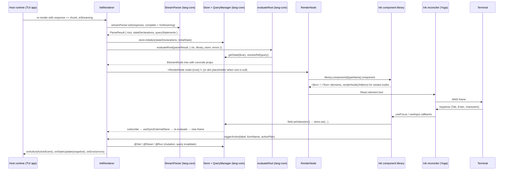

# @openuidev/ink-lang

Terminal (TUI) runtime for OpenUI Lang, built on [Ink](https://github.com/vadimdemedes/ink). It renders the same streamed OpenUI Lang programs as `@openuidev/react-lang`, with the same component names, positional arguments and schemas, so one system prompt serves a web app and a terminal app.

[](https://github.com/thesysdev/openui/blob/main/LICENSE)

**Links:** [OpenUI Lang docs](https://openui.com/docs/openui-lang) | [GitHub repo](https://github.com/thesysdev/openui)

## Install

```bash
npm install @openuidev/ink-lang ink react zod
# or
pnpm add @openuidev/ink-lang ink react zod
```

**Peer dependencies:** `ink ^8.0.0`, `react >=19.3.0`, `zod ^3.25.0 || ^4.0.0`. Node 22 or newer. The package is ESM only, like Ink.

## Overview

1. **Render streamed output** with `<InkRenderer>` inside your Ink app as the OpenUI Lang arrives.
2. **Use the default terminal library** (`inkLibrary`) whose components mirror the React default library, or **define your own** Ink components with `defineComponent` and `createLibrary`.
3. **Receive actions and state** through `onAction` and `onStateUpdate`; the components never talk to your host directly.

## Quick start

```tsx
import { Box, render, Text } from "ink";
import { useEffect, useState } from "react";
import { InkRenderer, inkLibrary, type ActionEvent } from "@openuidev/ink-lang";

function App() {
  const [response, setResponse] = useState("");
  const [isStreaming, setIsStreaming] = useState(true);
  const [lastEvent, setLastEvent] = useState<ActionEvent | null>(null);

  useEffect(function stream() {
    // Append each chunk of the model's response, then flip isStreaming off at the end.
    void streamFromYourModel(setResponse).then(function done() {
      setIsStreaming(false);
    });
  }, []);

  return (
    <Box flexDirection="column">
      <InkRenderer
        response={response}
        library={inkLibrary}
        isStreaming={isStreaming}
        onAction={setLastEvent}
      />
      <Text dimColor>
        {lastEvent ? `${lastEvent.type}: ${lastEvent.humanFriendlyMessage}` : ""}
      </Text>
    </Box>
  );
}

render(<App />);
```

The system prompt comes from the library, exactly as with `react-lang`:

```ts
const systemPrompt = inkLibrary.prompt({ preamble: "You are a deployment assistant." });
```

The terminal library ships every component of the React default library with an identical schema, so one prompt serves both renderers. The parser drops components a custom library does not know and reports them through `onError` as `unknown-component` (or in the dim red error footer when no `onError` is passed), so the rest of the program still renders.

## Try it

```bash
pnpm --filter @openuidev/ink-lang demo
```

`examples/demo.tsx` streams a mock response chunk by chunk, logs every `onAction` event and the `onStateUpdate` snapshots under the rendered program. Tab and Shift+Tab move focus, Enter or Space presses a button, typing edits the field, Up and Down move through a Select, Esc quits.

## `InkRenderer` props

| Prop            | Type                                                          | Description                                                                                                                                                    |
| :-------------- | :------------------------------------------------------------ | :------------------------------------------------------------------------------------------------------------------------------------------------------------- |
| `response`      | `string \| null`                                              | The accumulated OpenUI Lang text, or a stored message with `]]>openui:` markers                                                                                |
| `library`       | `Library`                                                     | A library from `createLibrary()`; `inkLibrary` is the default                                                                                                  |
| `isStreaming`   | `boolean`                                                     | True while the model is still producing the program: buttons and inputs are inactive, queries wait, errors are held back                                       |
| `onAction`      | `(event: ActionEvent) => void`                                | Button presses and custom actions, after `@Set`, `@Reset` and `@Run` steps have run                                                                            |
| `onStateUpdate` | `(state: Record<string, unknown>) => void`                    | The store snapshot after each user edit (never for declared defaults)                                                                                          |
| `initialState`  | `Record<string, unknown>`                                     | State to restore: `$`-prefixed keys are bindings, other keys are form state                                                                                    |
| `onParseResult` | `(result: ParseResult \| null) => void`                       | The raw parse result whenever it changes                                                                                                                       |
| `toolProvider`  | `Record<string, (args) => Promise<unknown>> \| McpClientLike` | Serves `Query()` and `Mutation()` calls once streaming ends                                                                                                    |
| `onError`       | `(errors: OpenUIError[]) => void`                             | Structured errors once streaming ends, `[]` when a new stream starts. Without it, errors are drawn as a red footer in the UI                                   |
| `theme`         | `Partial<InkTheme>`                                           | Colors for borders, headings, buttons, tags, callouts and trends: `accent`, `danger`, `muted`, `success`, `warning` (defaults: cyan, red, gray, green, yellow) |

While `isStreaming` is true and the root has not appeared yet, a dim `…` placeholder is drawn; a dim `streaming…` line sits under the tree until the stream ends, and `loading…` while a query is in flight.

## Components

Every component keeps the name, positional argument order, Zod schema and description of its `@openuidev/react-ui` counterpart; a test compares them with the generated spec of the React default library.

| Component                                                                                            | Signature                                                                       | Terminal rendering                                                                                                                      |
| :--------------------------------------------------------------------------------------------------- | :------------------------------------------------------------------------------ | :-------------------------------------------------------------------------------------------------------------------------------------- |
| `Stack`                                                                                              | `Stack(children, direction?, gap?, align?, justify?, wrap?)`                    | Ink `Box`; gap tokens become 0 to 3 cells                                                                                               |
| `Card`                                                                                               | `Card(children, variant?, direction?, gap?, align?, justify?, wrap?)`           | Round border (`card`), single dim border (`sunk`), no border (`clear`)                                                                  |
| `CardHeader`                                                                                         | `CardHeader(title?, subtitle?)`                                                 | Bold title line and dim subtitle line                                                                                                   |
| `TextContent`                                                                                        | `TextContent(text, size?)`                                                      | Markdown (headings, lists, bold, italic, code, links); `small` dim, `small-heavy` bold dim, `large` bold, `large-heavy` bold underlined |
| `Button`                                                                                             | `Button(label, action?, variant?, type?, size?)`                                | `[ label ]`, inverse when focused, red when `destructive`, dim while streaming                                                          |
| `Buttons`                                                                                            | `Buttons(buttons, direction?)`                                                  | Row (default) or column of buttons                                                                                                      |
| `Input`                                                                                              | `Input(name, placeholder?, type?, rules?, value?)`                              | Single-line editor with a block cursor; `password` masks; `value` takes a `$binding`                                                    |
| `Select`                                                                                             | `Select(name, items, placeholder?, rules?, value?, size?)`                      | Picked label or dim placeholder; focused it opens the option list, Up and Down move, Enter or Space picks; `value` takes a `$binding`   |
| `SelectItem`                                                                                         | `SelectItem(value, label)`                                                      | One option of a Select (not drawn on its own)                                                                                           |
| `Form`                                                                                               | `Form(name, buttons, fields?)`                                                  | Scopes its fields under the form name and owns their validation; draws the fields, then the buttons                                     |
| `FormControl`                                                                                        | `FormControl(label, input, hint?)`                                              | Bold label (`*` when required), the input, the dim hint or the red validation error                                                     |
| `Label`                                                                                              | `Label(text)`                                                                   | Plain text                                                                                                                              |
| `Table`                                                                                              | `Table(columns)`                                                                | Bold header, dim rule, one line per row; widths from the widest cell, `number` columns right aligned, wide rows clipped                 |
| `Col`                                                                                                | `Col(label, data, type?)`                                                       | One column of a Table: `data` is one value or component per row (not drawn on its own)                                                  |
| `Tabs`                                                                                               | `Tabs(items)`                                                                   | Focusable tab strip (active tab bold and underlined, inverse when focused); Left and Right switch; only the active content is mounted   |
| `TabItem`                                                                                            | `TabItem(value, trigger, content)`                                              | One tab of a Tabs strip (not drawn on its own)                                                                                          |
| `BarChart`, `HorizontalBarChart`, `RadarChart`                                                       | `BarChart(labels, series, variant?, xLabel?, yLabel?, height?)` and friends     | One text bar per label and series with the value; `Series(category, values)` carries the numbers                                        |
| `LineChart`, `AreaChart`                                                                             | `LineChart(labels, series, variant?, xLabel?, yLabel?, height?)`                | One sparkline per series with its range and the first and last label                                                                    |
| `PieChart`, `RadialChart`, `SingleStackedBarChart`                                                   | `PieChart(labels, values, variant?, appearance?)` and friends                   | A colored proportion bar and a legend with percentages                                                                                  |
| `ScatterChart`                                                                                       | `ScatterChart(datasets, xLabel?, yLabel?)`                                      | One summary line per `ScatterSeries(name, points)`: point count and x/y ranges                                                          |
| `TextArea`                                                                                           | `TextArea(name, placeholder?, rows?, rules?, value?)`                           | Multi-line editor padded to `rows` lines; Enter inserts a newline, Up and Down move between lines                                       |
| `CheckBoxGroup`, `CheckBoxItem`                                                                      | `CheckBoxGroup(name, items, rules?, value?)`                                    | `[x] label` per item with a dim description; one focus stop, Up and Down move, Space toggles; stores `{ itemName: boolean }`            |
| `RadioGroup`, `RadioItem`                                                                            | `RadioGroup(name, items, defaultValue?, rules?, value?)`                        | `(•) label` per item; one focus stop, Up and Down move, Space picks; stores the value                                                   |
| `SwitchGroup`, `SwitchItem`                                                                          | `SwitchGroup(name, items, variant?, value?)`                                    | `[on ]` / `[off]` per item, optional card or sunk border; stores `{ itemName: boolean }`                                                |
| `Slider`                                                                                             | `Slider(name, variant, min, max, step?, defaultValue?, label?, rules?, value?)` | `├━━●──┤ value` track; Left and Right move by `step` (default 1); stores `[value]`                                                      |
| `DatePicker`                                                                                         | `DatePicker(name, mode?, rules?, value?)`                                       | `YYYY-MM-DD` (or `from to to` in range mode); Left and Right pick the segment, Up and Down change it; stores an ISO string              |
| `Chips`, `ChipItem`                                                                                  | `Chips(name, type?, items?, rules?, defaultValue?)`                             | Row of `[ label ]` chips, `[✓ label]` when selected; one focus stop, arrows move, Space toggles; stores a value or a list               |
| `OptionCards`, `OptionCard`                                                                          | `OptionCards(name, type?, items?, rules?, defaultValue?)`                       | Column of bordered cards (accent when selected) with the icon or image placeholder, title and subtitle; same keys as Chips              |
| `EditableTable`                                                                                      | `EditableTable(name?, columns?, data?)`                                         | Header, rule and one focusable cell per value; Tab moves between cells, select cells cycle with Up and Down; stores the edited rows     |
| `Accordion`, `AccordionItem`                                                                         | `Accordion(items)`                                                              | `▸ trigger` headers, one focus stop each; Enter or Space opens (`▾`) and closes the section                                             |
| `Steps`, `StepsItem`                                                                                 | `Steps(items)`                                                                  | `1. Title` in bold with the dim details under it                                                                                        |
| `Carousel`                                                                                           | `Carousel(children, variant?)`                                                  | One item visible under a focusable `◂ n / total ▸` line; Left and Right move                                                            |
| `Separator`                                                                                          | `Separator(orientation?, decorative?)`                                          | A dim rule across the available width (or a `│` column in a row)                                                                        |
| `Modal`                                                                                              | `Modal(title, open?, children, size?)`                                          | Accent-bordered box with the bold title and a focusable `[ x ]`, drawn while `$open` is true; closing sets it to false                  |
| `Callout`, `TextCallout`                                                                             | `Callout(variant, title, description, visible?)`                                | Left border in the variant color, bold title, description; a bound `$visible` hides it and auto-dismisses after 3s                      |
| `Tag`, `TagBlock`                                                                                    | `Tag(text, icon?, size?, variant?)`, `TagBlock(tags, size?)`                    | `[text]` in the variant color; TagBlock is a wrapping row of them                                                                       |
| `Icon`                                                                                               | `Icon(name, category?)`                                                         | The icon name in angle brackets, dim: `<rocket>`                                                                                        |
| `IconButton`                                                                                         | `IconButton(name, icon, action?, variant?, size?, shape?)`                      | `[ <icon> name ]`, focusable like a Button                                                                                              |
| `Image`, `ImageBlock`, `ImageGallery`                                                                | `Image(alt, src?)`, `ImageBlock(src, alt?)`, `ImageGallery(images)`             | A dim `▣ alt` placeholder line per image (the url when there is no alt); nothing is fetched                                             |
| `CodeBlock`                                                                                          | `CodeBlock(language, codeString)`                                               | Single-line box with the dim language label and the code as written                                                                     |
| `MarkDownRenderer`                                                                                   | `MarkDownRenderer(textMarkdown, variant?)`                                      | The same markdown subset as TextContent, in a card or sunk border when asked                                                            |
| `InlineHeader`                                                                                       | `InlineHeader(heading, description?)`                                           | Bold heading and dim description                                                                                                        |
| `EntityList`                                                                                         | `EntityList(rows?, size?, header?, footer?)`                                    | Two aligned columns, numbers right-aligned, bold header, footer under a rule                                                            |
| `ListBlock`, `ListItem`                                                                              | `ListBlock(items, variant?, size?)`                                             | `1. title` (or `▣ title`) with a dim subtitle; items with an action are focus stops that fire it on Enter                               |
| `Text`, `BoldText`                                                                                   | `Text(variant?, value, subtext?, subtextVariant?, size?)`                       | The value line and a dim subtext line (`metric` subtexts green or red by sign)                                                          |
| `IconText`, `ImageText`, `ImageTextLarge`                                                            | `IconText(icon, iconVariant?, iconSize?, title, subtitle?, bold?, layout?)`     | `<icon> title` / `▣ title` with a dim subtitle; the large variant puts the placeholder line above a bold title                          |
| `MetricIndicatorInline`, `MetricIndicatorWithStrikethrough`                                          | `MetricIndicatorInline(value, subtext?, trend?)`                                | `value  +12%  subtext`; the strikethrough variant strikes the previous value and puts the subtext below                                 |
| `SnippetCardBlock`, `OverviewCardBlock`, `ContextCardBlock`, `CompositeCardBlock`, `VisualCardBlock` | `SnippetCardBlock(items, layout?, responsive?, action?, gap?)` and friends      | One dim bordered text block per `*CardItem`; with an `action` every card is a focus stop and Enter fires it with the item context       |

Every schema, child union included, is identical to react-ui's; the parity test compares them byte for byte.

Keyboard: Tab and Shift+Tab move between focus stops (Ink's focus manager): buttons, inputs, selects, option groups, tab strips, accordion headers, carousels, table cells and pressable cards. Enter or Space presses the focused button, toggles the option under the cursor or opens a section. In a focused text field, printable keys insert, Backspace and Delete remove, Left, Right, Home and End move the cursor; in a TextArea Enter inserts a newline and Up and Down move between lines. Up and Down (or Left and Right) move inside a group; Left and Right move a Slider by its step, switch tabs or carousel items and pick a DatePicker segment, which Up and Down change. While a query is loading a spinner line shows under the program, and a failed query leaves a focusable `[ retry ]` that re-runs it.

## Defining your own components

```tsx
import { Text } from "ink";
import { z } from "zod/v4";
import {
  createLibrary,
  defineComponent,
  Stack,
  type ComponentRenderProps,
} from "@openuidev/ink-lang";

const GreetingSchema = z.object({
  name: z.string(),
  mood: z.enum(["happy", "excited"]).optional(),
});

function GreetingRenderer({ props }: ComponentRenderProps<z.infer<typeof GreetingSchema>>) {
  return <Text bold={props.mood === "excited"}>Hello, {props.name}!</Text>;
}

export const Greeting = defineComponent({
  name: "Greeting",
  description: "Greets the user",
  props: GreetingSchema,
  component: GreetingRenderer,
});

export const library = createLibrary({ root: "Stack", components: [Stack, Greeting] });
```

Inside a renderer, `useTriggerAction()`, `useStateField(name, value)`, `useFormName()`, `useIsStreaming()`, `useIsQueryLoading()` and `useRenderNode()` give access to the runtime. `useFocusable({ isActive })` registers the component with Ink's focus manager; `reactive(schema)` marks a prop as bindable with `$variables`. Primitive children are wrapped in `Text` automatically because Ink refuses bare strings outside `Text`.

## How a chunk becomes a frame



## Errors and streaming

- Nothing a model writes can crash the renderer: a parser crash becomes a `parse-exception` error, a component that throws is caught by an error boundary that keeps its last good frame and reports `render-error`, and a program that produced no statements reports `parse-failed`.
- Errors are collected only once `isStreaming` is false, so half-written programs never report `unknown-component` or `missing-required` by mistake.
- `onStateUpdate` fires once per user edit; `@Set` and `@Reset` steps count as edits.
- `ink-lang` never writes to the console. If you pass no `onError`, the errors are drawn under the program instead. (`lang-core` itself logs a failed query with `console.error`; Ink's `patchConsole` keeps that above the frame.)

## Telemetry

`ink-lang` sends nothing. It uses `createStreamingParser` and `library.prompt()` from `@openuidev/lang-core`, which are not instrumented. See the `lang-core` README for the flags that disable the rest of that package's telemetry.

## Validation

The `rules` of every input (`{ required, email, url, numeric, min, max, minLength, maxLength, pattern }`) are checked when focus leaves the field, after an edit of a group, slider, date or selection, and before a primary `Button` fires a step that leaves the form (`@ToAssistant`, a mutation, a custom action). `FormControl` shows the error in place of the hint and marks required fields with `*`. Secondary buttons and purely local steps (`@Set`, `@Reset`) skip validation, as in the React default library.

## Not in this version

| Item               | Planned approach                                                                                                                                            |
| :----------------- | :---------------------------------------------------------------------------------------------------------------------------------------------------------- |
| `Combobox`         | Reuse the schema; a `Select` with a filter line on top                                                                                                      |
| Table paging       | `contentOffsetY` paging for tables taller than the terminal; today every row is drawn                                                                       |
| Chart shapes       | The terminal charts are textual (bars, sparklines, proportion bars); braille plotting for line and scatter charts could follow                              |
| Grid card layouts  | Card blocks, OptionCards and Carousel stack their items in a column; a row layout for wide terminals could follow                                           |
| Typed date entry   | DatePicker edits with the arrow keys only; typing digits into a segment could follow                                                                        |
| Selection defaults | Chips and OptionCards show their `defaultValue` but, unlike react-ui, do not write it to the store until the user toggles (no `onStateUpdate` for defaults) |

## License

MIT. See the repository [LICENSE](https://github.com/thesysdev/openui/blob/main/LICENSE).
